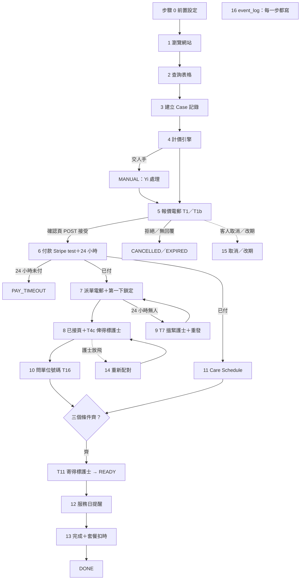
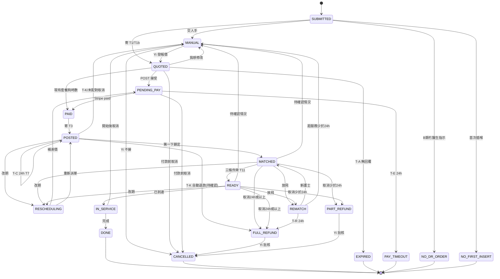
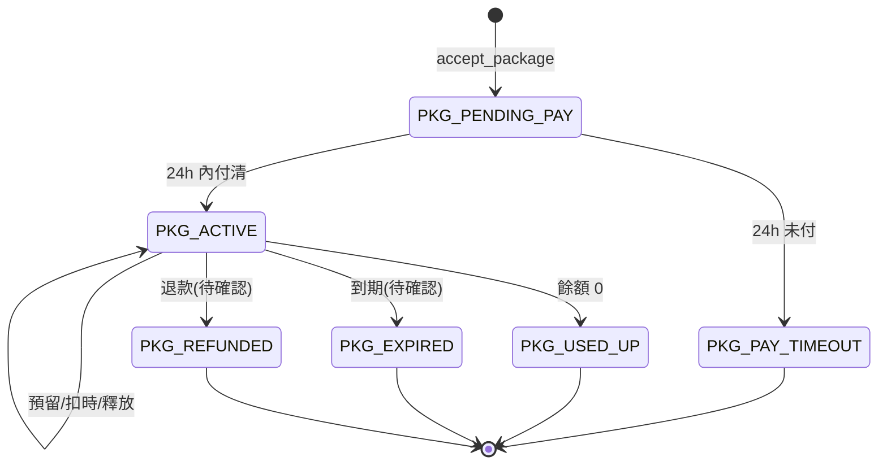

# 上門註冊護士（RN）平台：工作流程規格 v3（電郵版 build spec）

> 版本：v3-email 草稿｜日期：2026-10-29（四）HKT｜狀態：**草稿，待 Yi 審閱**
> 取代：喺電郵路線下取代 `platform_workflow_spec_v2.md`（v2 保留不改，仍然係 WhatsApp 路線嘅原文）
> 合併來源：spec v2（全部平台邏輯）＋`solution2_email_workflow.md`＋`trl3_two_solutions_for_dev.md`（電郵路線改動）＋ gov.hk 2026–2027 公眾假期表（附錄 A）
> 用途：交俾開發同事，佢會貼入 AI 編程助手用。所以**識別碼（狀態、欄位、範本 ID、事件名）一律用英文**，解釋用繁體中文。
> ❗ 本文件冇任何測試結果；金額係規則計出嚟嘅預期值；工時係估算；所有個案虛構。

---

## 0. 給 AI 嘅指示（AI 編程助手請先讀）

1. **建造次序**：先做所有標 `✅切片` 嘅部分，令第 4 節步驟 2→3→4→5→6→7→8→9→16 可以由頭行到尾；之後先做 `✅加做`。`⏳公司註冊後` 同 `❌不做` 唔好做，只可以留介面（例如一個返回「交人手」嘅函數）。
2. **唔好自創規則**。所有業務規則只可以嚟自本文件。本文件冇寫嘅情況 → 狀態轉 `MANUAL`，寫一行 `event_log`（`event = manual.routed`，`reason` 寫清楚），寄 T14 管理員警示。
3. **標 `【待確認】`／`【假設】`／`【建議】`／`【草稿】` 嘅規則**：程式入面一律有一個設定開關；預設值 = 「交人手」（`MANUAL`），除非本文件明確寫「預設照做」。呢啲規則**唔入驗收測試嘅合格標準**。
4. **計價、時間計算、先到先得、狀態轉換全部用固定程式規則**，唔可以叫 LLM 計或者揀。LLM 只可以做第 12 節列明嘅工作。
5. **所有數字由 `settings` 表讀**，唔好寫死（spec v2 §0.4）。
6. **所有時間**：伺服器時間、香港時間（`Asia/Hong_Kong`，UTC+8），存 ISO 8601 帶時區，精確到毫秒。
7. **電郵入面嘅連結唔可以直接改資料**（GET 只顯示確認頁；POST 先生效），見 3.3。
8. **狀態轉換只可以跟第 5 節嘅轉換表**；表以外嘅轉換一律拒絕並記錄 `event = transition.rejected`。
9. **次序唔可以調轉**：客人接受報價 → 付款 → 先派單配對（spec v2 §4 已確認）。
10. **測試資料只用第 14 節虛構個案**；唔好接駁任何真病人資料來源。
11. 每封電郵都要記低 `template_id` 同 `template_version`；範本字眼照第 8 節，唔好改寫。
12. 每做完一步，用第 14 節對應嘅驗收測試自己驗一次。

---

## 1. 標記、角色、慣例

### 1.1 範圍標記（每一步都有）
| 標記 | 意思 |
|---|---|
| `✅切片` | 最細切片，**10-31（六）12:00 檢查點前一定要行得通**。最細切片約 8–12 小時（📝 估算，唔係承諾） |
| `✅加做` | 而家做得到；切片完成而時間許可先做。證據 10-31（六）21:00 凍結 |
| `⏳公司註冊後` | 留待公司註冊之後／TRL 4 階段先做（例如真收款、真退款、正式寄件網域、真實用戶、護士入職全流程） |
| `❌不做` | 今次範圍以外，唔做、唔示範；程式遇到 → `MANUAL` |

### 1.2 規則標記
| 標記 | 意思 |
|---|---|
| 〔確〕 | spec v2 標【已確認 2026-10-29】，照做，可以做合格標準 |
| 【待確認】【假設】【建議】【草稿】 | 未定；預設「交人手」（見第 0 節第 3 點）；唔入合格標準 |
| 📝 | 電郵版新加或者渠道改動（v2 冇），要 Yi 確認 |

### 1.3 角色（`actor` 欄用）
| actor | 角色 | 做咩 |
|---|---|---|
| `system` | 系統 | 表格驗證、狀態轉換、計時器、token、寄電郵、Stripe 回傳 |
| `ai` | AI 助手 | 只限第 12 節：整理資料、出 Care Schedule 草稿 |
| `admin` | Yi（管理員） | 例外處理、覆核、退款批核、護士核實、黑名單、Care Schedule 最終確認 |
| `senior_nurse` | 資深護士 | 審核 Care Schedule（臨床角度）、核對醫生指示 |
| `nurse` | 接單護士 | 收派單電郵、撳接單、確認提醒 |
| `family` | 客人／家屬 | 填表、接受報價、付款、提供單位 |

### 1.4 慣例
- 金額：港幣整數（HKD）；Stripe 用最細單位（HK$1 = 100）。
- `case_id`：`C2026-0001` 格式（測試個案可以用 C01–C20 做 `test_ref`）。
- 日期：`YYYY-MM-DD`；時間：`HH:MM`（24 小時制，30 分鐘一格）。
- 夜更嘅「日期」= 開始（22:00）嗰日（spec v2 2.2 第 3x 欄）。
- 所有電郵標題前加「【測試】」，內文最尾加：「此為 CUHK TSSSU 申請之模擬測試，所有資料均為虛構。」（📝，測試期間用；正式上線時移除）

---

## 2. v3 相對 v2 改動（電郵路線）

| # | 改動 | v2 | v3（電郵） | 章節 |
|---|---|---|---|---|
| 1 | 渠道 | WhatsApp（客服 auto、大群、私人 WhatsApp） | 電郵（客人、護士、Yi 都用電郵）＋網頁確認頁 | 3、8、9 |
| 2 | 聯絡欄位 | `whatsapp`（必填） | `email`（必填）；`phone`（選填，T11 用）📝 | 4.2、10 |
| 3 | 客人回覆「1」／「2」／「確認」 | 打字回覆 | 電郵按掣 → 確認頁 → POST 📝 | 4.5、8 |
| 4 | 防連結掃描 | — | 一次性 token＋確認頁（GET 唔改資料） | 3.3 |
| 5 | 付款 | 付款方式待確認 | Stripe test mode Checkout Session（`expires_at` = 24 小時）；PayMe 未確認 | 4.6 |
| 6 | 派單 | WhatsApp 大群＋DM「我要做 case」 | 派單電郵寄每位已核實護士，每人一條個人接單連結 | 4.7 |
| 7 | 先到先得 | 按 WhatsApp 系統收到時間 | 伺服器時間＋原子更新（第一個 POST 鎖定） | 4.7、4.8 |
| 8 | T5「已俾人做」 | 大群公告 | 可選：寄俾所有收過派單嘅護士 | 4.8 |
| 9 | 單位號碼 | 私人 WhatsApp 問 | T16 電郵＋單位表格連結 📝 | 4.10 |
| 10 | T11 | 私人 WhatsApp | 只寄得標護士電郵 | 4.11 |
| 11 | 提醒確認 | 回覆「確認」 | 電郵「確認」掣 📝 | 4.12 |
| 12 | 計時器 | 未指定 | 排程程式每 1 分鐘掃一次（Apps Script time-driven trigger 或 Supabase `pg_cron`）；`time_scale` 測試模式 | 3.4、7 |
| 13 | 付款前取消 | 有狀態冇範本 | 新草稿範本 X05 📝 | 8 |
| 14 | 公眾假期 | 「香港政府公佈」 | 已抄入 gov.hk 2026、2027 官方表（附錄 A）；星期日一律計〔確〕 | 6、附錄 A |
| 15 | T3 測試版 | 欄位齊全 | 測試版只顯示地區＋大廈（＋日期時間、薪酬行、照顧重點）📝 | 4.7、13 |
| 16 | 紀錄 | `audit_log` | 統一 `event_log`（只加唔改） | 4.16、11 |

---

## 3. 系統架構

### 3.1 組件
| 組件 | 做咩 | 選項 A（最快） | 選項 B |
|---|---|---|---|
| 網站／表格 | 登陸頁、查詢表格、確認頁 | Apps Script web app（HtmlService）或網站初稿 | Next.js |
| 資料庫 | 第 10 節所有表 | Google Sheets（每表一個 tab） | Supabase Postgres（或 Firebase Firestore） |
| 寄信 | 第 8 節範本 | `MailApp` | Resend 或 Gmail SMTP |
| 付款 | Stripe test mode | `UrlFetchApp` 開 Checkout Session；每分鐘查狀態 | Stripe SDK＋webhook |
| 排程 | 第 7 節計時器 | time-driven trigger 每 1 分鐘 | Supabase `pg_cron` 每 1 分鐘 |
| 鎖 | 先到先得 | `LockService.getScriptLock()` | `UPDATE … WHERE … RETURNING` |
| 管理後台 | Yi 覆核、批核 | Sheets 加 checkbox＋Apps Script 按鈕 | 簡單 admin 頁 |

### 3.2 渠道
- 客人：`clients.email`；護士：`nurses.email`；Yi：`settings.admin_email`（測試用 Yi 嘅測試電郵）。
- 唔用 WhatsApp、唔用 SMS（SMS 要錢、試用帳戶限制多，`❌不做`）。

### 3.3 連結、token、確認頁（防電郵掃描誤觸）
1. 每個要用戶做決定嘅掣都係一條連結：`{BASE_URL}/a?t={token}`。
2. `token`：最少 128-bit 隨機值（例如 UUID v4），存 `tokens` 表：`token`、`case_id`、`actor_code`、`action`、`created_at`、`expires_at`、`used_at`。
3. **GET**（打開連結）：只顯示確認頁（P01–P10，見第 9 節）＋一個確認掣；**唔改任何資料**；寫 `event = link.opened`。
4. **POST**（撳確認頁嘅掣）：檢查 token 有效（存在、未用、未過期、`action` 啱、Case 狀態容許）→ 執行動作 → `used_at = now()` → 寫 event。
5. token 已用 → 顯示 P09「連結已失效」；已過期 → P09；Case 狀態唔容許（例如已取消）→ P09 並顯示目前狀態。
6. 原因：有啲電郵系統會預先打開信入面嘅連結做安全掃描；如果 GET 都改資料，就會自動接受報價或者自動接單。

### 3.4 排程（計時器）
- 一個排程函數 `tick()` 每 1 分鐘行一次：揀出 `timers` 表 `due_at <= now() AND fired_at IS NULL AND cancelled_at IS NULL`，逐個執行到期動作（第 7 節），然後設 `fired_at`。同一個計時器唔會觸發兩次。
- 計時器喺觸發條件消失時要取消（例如已付款 → 取消 T-E），設 `cancelled_at`。
- 測試模式：`settings.time_scale`（例如 60 = 1 小時當 1 分鐘）。`due_at = start + duration / time_scale`。每行 log 記低 `time_scale`。正式模式 `time_scale = 1`。
- ⚠️ **唔好用 Vercel 免費（Hobby）cron 做分鐘級計時器**：Vercel 官方文件寫明 Hobby 方案 cron 每日只可以行一次，而且有大約 1 小時誤差。
- Apps Script 配額（Google 官方配額頁，2026-09-03 UTC 更新，可能會改）：一般 Gmail 帳戶 trigger 總運行時間每日 90 分鐘、每次執行最多 6 分鐘；`MailApp` 每日 100 個收件人（Workspace 帳戶每日 1,500）。可以用 `MailApp.getRemainingDailyQuota()` 查剩幾多。

### 3.5 Stripe test mode
- 用 test secret key（`sk_test_…`），放 Script Properties／環境變數，**唔好放 Sheet、唔好 commit**。
- 開 Checkout Session：`mode=payment`、`currency=hkd`、`line_items[0][price_data][unit_amount] = 金額 × 100`、`metadata[case_id]`、`client_reference_id = case_id`、`expires_at = now + 24 小時`（Stripe 官方文件：`expires_at` 可以設喺建立後 30 分鐘至 24 小時之間）、`success_url`／`cancel_url` = 本系統頁面。
- 付款狀態：選項 A 每分鐘 `GET /v1/checkout/sessions/{id}`，睇 `payment_status = paid`；選項 B 收 webhook `checkout.session.completed`（要驗簽名）。Apps Script web app 收 POST 有轉址問題，所以選項 A 用查詢方式。
- 用 Stripe 官方測試卡；所有證據截圖要見到「Test mode」。
- 退款（`✅加做`，只示範）：`POST /v1/refunds`（test）；真退款 `⏳公司註冊後`。
- PayMe：香港 PayMe for Business 有冇俾未註冊公司用嘅測試環境，**未確認**；今次唔用。（另一間外國公司都叫 PayMe（payme.io），唔係 HSBC PayMe。）

---

## 4. 完整流程（嚴格次序）

> 每一步都用同一個格式：範圍｜觸發條件｜輸入｜處理邏輯（if／else）｜輸出｜狀態轉換｜email 範本｜計時器｜負責。
> 「→ MANUAL」= 狀態轉 `MANUAL`＋`event_log`（`manual.routed`，寫原因）＋寄 T14（`事件 = 交人手`）俾 Yi。

### 總覽


---

### 步驟 0：前置設定
| 項目 | 內容 |
|---|---|
| 範圍 | `✅切片`（護士入職全流程 T25／T25b／T26 屬 `⏳公司註冊後`） |
| 觸發條件 | 部署前一次；之後 Yi 改設定時 |
| 輸入 | 第 10.5 節 `settings`；附錄 A 假期表；附錄 B 偏遠名單 `/workspace/workflow/remote_area_surcharge_v2.md`（記版本）；測試護士 |
| 處理邏輯 | ① 建立第 10 節所有表；② 匯入 `holidays`（附錄 A 全部 34 個日期，2026＋2027；記 `source_url`、`fetched_at = 2026-10-29`）；③ 匯入 `remote_list`（記 `list_version`）；④ 建立測試護士 N01–N05：N01–N04 `nurse_status = VERIFIED`，N05 = `APPLIED`（未核實，用嚟測試拒絕）；全部用 Yi／隊友控制嘅測試電郵；⑤ 設 `time_scale`（測試 60；正式 1）；⑥ Stripe test key 放 Script Properties |
| 輸出 | 系統可用；`event = setup.completed` |
| 狀態轉換 | 無 |
| email 範本 | 無（護士入職：T25、T25b、T26，`⏳`） |
| 計時器 | 啟動 `tick()` 每 1 分鐘 |
| 負責 | `system`（開發同事）、`admin`（核對設定） |

### 步驟 1：瀏覽網站（登陸頁）
| 項目 | 內容 |
|---|---|
| 範圍 | `✅切片`（一頁就夠；完整網站 `✅加做`） |
| 觸發條件 | 訪客打開網站 |
| 輸入 | 無 |
| 處理邏輯 | 頁面簡單、短、字大、對比清楚（目標：長者及年長家屬）；只介紹 RN 上門護理，以長者護理為主；每頁一個主要掣「查詢服務」。收費部分必須列出：日間／夜間時段、星期日及公眾假期 +HK$30／小時、付款期限 24 小時、取消／改期規則（≥24 小時免費）、工具物料由客人自備、30 小時套餐 HK$8,650；「偏遠地區不另收費」【建議】。測試期間頁頂顯示「模擬測試，請勿輸入真實病人資料」📝 |
| 輸出 | 撳「查詢服務」→ 步驟 2 |
| 狀態轉換 | 無 |
| email 範本 | 無 |
| 計時器 | 無 |
| 負責 | `system` |

- 設計風格參考網站：【待確認：Yi 未提供】。

### 步驟 2：查詢表格
| 項目 | 內容 |
|---|---|
| 範圍 | `✅切片`（電郵查詢由同事人手轉錄入表格 = `✅加做`；自動解讀電郵 = `⏳`） |
| 觸發條件 | 客人撳「查詢服務」 |
| 輸入 | 2.1 欄位表 |
| 處理邏輯 | 見下面 2.2 驗證規則（全部喺提交前做，唔合規則唔可以提交）；提交前顯示「資料確認」頁；客人撳「確認提交」先提交 |
| 輸出 | 表格資料 → 步驟 3；網頁顯示 P02「已收到查詢」 |
| 狀態轉換 | （步驟 3 建立 `SUBMITTED`） |
| email 範本 | X01「已收到查詢」📝（可選，`✅加做`） |
| 計時器 | 無 |
| 負責 | `family`（填）、`system`（驗證） |

**2.1 欄位（`field_id` 用英文）**
| # | field_id | 標籤 | 類型 | 必填 | 規則／選項 |
|---|---|---|---|---|---|
| 1a | `surname` | 姓氏 | 文字 | 是 | 例：陳 |
| 1b | `gender` | 性別 | 單選 | 是 | `M`／`F` |
| 1c | `age` | 年齡 | 整數 | 是 | 0–120 |
| 1d | `district` | 地區 | 單選 | 是 | 香港十八區；`sub_district` 第二層下拉【建議】 |
| 1e | `building` | 大廈／屋苑／村名 | 文字 | 是 | 提示：「例如：半山樓、長洲大新街某大廈、蓮麻坑村」；**唔問單位號碼**〔確〕 |
| 2a | `weight_kg` | 體重 | 數字 | 是 | |
| 2b | `height_cm` | 身高 | 數字 | 是 | ≥ `tall_threshold_cm` → `tall_flag`；門檻【待確認】（未定前唔標） |
| 3 | `services[]` | 護理服務 | tick box 多選 | 至少一項 | 見 2.3；**唔可以淨係自由文字**〔確〕 |
| 3t | `services[].preferred_times[]` | 偏好時間／習慣時間 | `HH:MM` 清單 | 否 | 每個已 tick 項目一格；可填多個（「、」或逗號分隔） |
| 3p | `services[].prn` | 按需要（PRN） | 勾選 | 否 | tick 咗唔使填時間、唔設提醒 |
| 3o | `other_need_text` | 其他護理需要 | 一行文字 | 否 | 有內容 → `other_need_review = true` → 報價前 MANUAL【建議】 |
| 3m | `doctor_order` | 有冇醫生指示／處方 | 單選 `YES`／`NO`／`UNSURE` | 揀咗任何 B 類項目就必填〔確〕 | 見 2.5 |
| 3n | `existing_tube[item_id]` | 病人而家係咪已經有呢條喉？ | 單選 `YES`／`NO_FIRST_INSERT`／`UNSURE` | 揀咗任何「只換唔插」項目就必填〔確〕 | 每個「只換唔插」項目問一次，見 2.4 |
| 3w | `shift_type` | 時段類別 | 單選 | 是 | `DAY`／`NIGHT10`（22:00–翌日 08:00）／`NIGHT12`（22:00–翌日 10:00）〔確〕 |
| 3x | `visits[].date` | 服務日期 | 日期（可多個） | 是 | 夜間日期 = 22:00 開始嗰日 |
| 3y | `visits[].start_time` | 開始時間 | `HH:MM`，30 分鐘一格【建議】 | 日間必填 | 夜間自動 22:00，唔可以改 |
| 3z | `visits[].end_time` | 結束時間 | `HH:MM`，30 分鐘一格【建議】 | 日間必填 | 夜間自動 08:00／10:00 |
| 4 | `mobility` | 行動能力 | 單選 | 是 | 需人輔助／臥床／輪椅／手推車／行架／可自行出門 |
| 5 | `recent_3m[]` | 近三個月情況 | 多選 | 否 | 嚴重疾病；跌倒／頭暈／失去平衡；進食／吞嚥困難；疼痛；壓瘡／手術傷口等；以上皆無 |
| 6 | `email` | 電郵 | email | **是** 📝 | 所有通知經呢個電郵（取代 v2 WhatsApp） |
| 6b | `phone` | 聯絡電話 | 8 位數字 | 否 📝 | 只用於 T11 俾得標護士；【待確認：要唔要必填】 |
| 7 | `medical_history` | 病史 | 文字 | 否 | 提示：「例如：心臟衰竭（有植入 ICD）、腎衰竭、糖尿病」 |
| 8 | `companion` | 服務時間有冇人陪伴 | 單選 | 是 | 有／冇／部分時間有 |
| 9 | `remarks` | 其他補充 | 文字 | 否 | 掃描紅旗字眼（第 12 節） |
| 10 | `consent` | 同意條款及私隱聲明 | 勾選 | 是 | 包括：同意將去識別化資料（地區＋大廈，唔含單位）以電郵發送俾護士；同意付款期限及取消政策【建議】；測試期間另加「我確認以上全部係虛構資料」📝 |

**2.2 驗證規則（提交前，`system`）**
```
IF 必填欄位未填 → 顯示錯誤，唔可以提交
IF shift_type == DAY:
    IF NOT (07:00 <= start_time < end_time <= 22:00):
        顯示「日間服務時間為早上 7 時至晚上 10 時，請重新揀選；如需晚上 10 時後服務，請揀夜間時段。」→ 唔可以提交   〔確〕
IF shift_type IN (NIGHT10, NIGHT12): start_time = 22:00；end_time = 08:00 或 10:00（唔可以改）
IF 想要跨 22:00 連續服務 → 要分開揀一段日間（例如 18:00–22:00）＋同日一段夜間（22:00–08:00）   〔確〕
FOR 每個 preferred_time:
    IF 格式唔係 HH:MM → 提示「請用 08:00 呢種格式」【建議】
    IF 唔喺服務時段內 → 提示「呢個時間唔喺你揀嘅服務時間內」【建議】
IF 定時項目（例如管道餵食）冇時間又冇 PRN → 溫馨提示，唔阻止提交【建議】
IF 揀咗任何 B 類項目 → doctor_order 必填
IF 揀咗任何「只換唔插」項目 → existing_tube 必填
```

**2.3 護理服務分類〔確〕**（tick box；每項有一句淺白解釋＋偏好時間格＋PRN 格）
| category | item_id | 名稱 | 需醫生指示 |
|---|---|---|---|
| `A` | `A_VITALS` | 檢測生命表徵（血壓、脈搏、體溫、血氧） | 否 |
| `A` | `A_GLUCOSE` | 血糖監測（篤手指度血糖） | 否 |
| `A` | `A_WOUND_SIMPLE` | 簡單傷口護理（細小傷口清洗換敷料） | 否 |
| `A` | `A_STOMA` | 造口護理（腸造口清潔、換袋） | 否 |
| `A` | `A_CATHETER_CARE` | 現有尿喉日常護理（清潔、倒尿袋，唔包括更換尿喉） | 否 |
| `A` | `A_TUBE_FEEDING` | 管道餵食（經現有鼻胃喉／胃造口喉／空腸喉，唔包括插／換喉） | 否 |
| `A` | `A_SUCTION` | 抽痰（包括按需要抽痰、拍痰） | 否 |
| `A` | `A_TRACHEOSTOMY` | 氣管造口護理 | 否 |
| `A` | `A_PD` | 腹膜透析（洗肚） | 否 |
| `B` | `B_TPN` | TPN（靜脈營養） | 是 |
| `B` | `B_PICC` | PICC（中央靜脈導管）護理 | 是 |
| `B` | `B_IV` | 靜脈注射 | 是 |
| `B` | `B_NG_CHANGE` | 更換鼻胃喉（只限更換現有喉管，不做首次插入） | 是（只換唔插） |
| `B` | `B_PEG_CHANGE` | 更換胃造口喉（只限更換現有胃造口喉，不做首次插入）【分類暫列 B，待確認】 | 是（只換唔插） |
| `B` | `B_CATHETER_CHANGE` | 更換尿喉（只限更換現有尿喉，不做首次插入） | 是（只換唔插） |
| `B` | `B_MEDICATION` | 藥物或注射（包括派藥、皮下／肌肉注射） | 是 |
| `B` | `B_WOUND_COMPLEX` | 複雜傷口護理 | 是 |
| `C` | `C_MOBILITY` | 行動協助（扶抱、轉位、行路） | 否 |
| `C` | `C_COMPANION` | 陪伴 | 否 |
| `C` | `C_ESCORT` | 陪診 | 否 |

- 「簡單傷口」同「複雜傷口」定義：【待確認：Yi 提供定義及例子】；客人揀「唔肯定」→ 當複雜傷口＋MANUAL【建議】。
- 唔顯示：母嬰類（已移除〔確〕）；將來服務（上門抽血等）；v1 未分類項目（尿袋更換、氧氣治療、紓緩等）【待確認，未確認前唔顯示】。
- `B_PEG_CHANGE` 分類未確認 → 程式遇到 → MANUAL（📝 保守做法）。

**2.4 「只換唔插」規則〔確〕**（`B_NG_CHANGE`、`B_PEG_CHANGE`、`B_CATHETER_CHANGE`）
```
FOR 每個只換唔插項目:
    IF existing_tube == NO_FIRST_INSERT → 成張單唔處理 → 狀態 NO_FIRST_INSERT → 寄 T27（草稿）   〔確〕（成張單 vs 只刪該項【待確認】）
    ELIF existing_tube == UNSURE → MANUAL【建議】
    ELSE (YES) → 照 2.5 醫生指示流程
```

**2.5 醫生指示規則〔確：冇醫生指示就唔處理〕**
```
IF services 包括任何 B 類:
    IF doctor_order == NO  → 成張單唔處理 → 狀態 NO_DR_ORDER → 寄 T18   〔確〕（A＋B 混合單成張唔做 vs 只刪 B【待確認】→ 混合單暫時 MANUAL 📝）
    ELIF doctor_order == UNSURE → MANUAL【建議】
    ELSE (YES) → doctor_order_status = PENDING_CHECK；照常報價
             → 付款後經表格連結上載醫生指示（測試用假文件）【建議】📝
```
- 註：v2 寫明 A＋B 混合單答「冇」= 成張單唔處理〔確〕，但「定只刪 B」仍待確認；為咗唔自創規則，**測試版**：純 B 類單答「冇」→ `NO_DR_ORDER`＋T18；A＋B 混合單答「冇」→ MANUAL 📝（`setting.mixed_no_order_mode = MANUAL`，可改做 `REJECT_ALL`）。

### 步驟 3：建立 Case 記錄
| 項目 | 內容 |
|---|---|
| 範圍 | `✅切片` |
| 觸發條件 | 步驟 2 提交成功 |
| 輸入 | 表格資料 |
| 處理邏輯 | ① 產生 `case_id`（`C2026-0001` 遞增）；② 寫入 `cases`（第 10.1 節）＋`visits`；③ `status = SUBMITTED`；④ 用 `email` 搵 `clients`，冇就新增（套餐用 email 識別客人 📝）；⑤ 依次行檢查：2.4 只換唔插 → 2.5 醫生指示 → 紅旗掃描（第 12 節）→ `other_need_review` → 急單（最早服務開始 − now < `min_lead_hours`（48）→ MANUAL【假設，待確認】）→ 偏遠核對（步驟 4.1）；⑥ 任何一項要停 → 轉相應狀態，唔再計價 |
| 輸出 | Case 記錄；交步驟 4 |
| 狀態轉換 | `[*] → SUBMITTED`；`SUBMITTED → NO_FIRST_INSERT`／`NO_DR_ORDER`／`MANUAL` |
| email 範本 | T27（首次插喉）、T18（冇醫生指示）、T14（交人手警示俾 Yi）；X03「同事核實中」（MANUAL 時俾客人）📝 |
| 計時器 | 無 |
| 負責 | `system`；紅旗字眼掃描 = 固定字詞清單（`system`），唔靠 LLM 判斷 |

### 步驟 4：計價引擎
| 項目 | 內容 |
|---|---|
| 範圍 | `✅切片`（只做〔確〕規則；其餘一律回 `MANUAL`） |
| 觸發條件 | Case `SUBMITTED` 而步驟 3 檢查全部通過 |
| 輸入 | `visits[]`、`holidays` 表、`is_sunday()`、`remote_list`、`settings`、客人有冇生效套餐 |
| 處理邏輯 | 第 6 節偽代碼 `price()`；偏遠核對 4.1；套餐判斷 4.2 |
| 輸出 | `quote_lines[]`、`quote_total`、`holiday_hours`、`holiday_surcharge`、`nurse_pay_lines[]`、`nurse_pay_total`、`remote_tier`、`nurse_travel_allowance`、`package_offer_shown`；或 `MANUAL`＋原因 |
| 狀態轉換 | 計到 → 去步驟 5（寄 T1 時轉 `QUOTED`）；計唔到 → `SUBMITTED → MANUAL` |
| email 範本 | 無（步驟 5 寄）；MANUAL → T14＋X03 |
| 計時器 | 無 |
| 負責 | `system`（固定程式）；LLM 唔可以計價 |

**4.1 偏遠核對（只影響護士交通津貼，客人報價唔變〔確〕）**
```
tier = lookup(remote_list, district, sub_district, building)   # 關鍵字比對；記 list_version
IF tier == A → nurse_travel_allowance = 150
ELIF tier == B → nurse_travel_allowance = 150；remote_review_required = true（派單前 Yi 覆核，T14g）【建議】
ELIF tier == C → nurse_travel_allowance = 0
ELSE (ADMIN / REJECT / UNMATCHED / 地區同大廈矛盾 / 同名歧義) → MANUAL（唔好估）
IF 尾班車／船早過 (end_time − 30 分鐘) → transport_time_flag = true【建議】
IF tier == A AND transport_time_flag 顯示冇車／船返 → MANUAL
```

**4.2 套餐顯示規則 📝**
```
IF 客人有 PKG_ACTIVE 套餐 → 用 T1b（唔再推銷）【草稿】
ELIF 全部 visits 都係 DAY 而且唔係星期日／公眾假期 AND 總計費時數 <= 30 → T1 顯示套餐選項
ELSE → T1 唔顯示套餐選項（夜間、假期、超過 30 小時點用套餐【待確認】）
```

### 步驟 5：報價電郵（接受／拒絕經確認頁）
| 項目 | 內容 |
|---|---|
| 範圍 | `✅切片`（T1 單次＋套餐掣；T1b 已有套餐 = `✅加做`） |
| 觸發條件 | 步驟 4 計到價；或 Yi 喺 MANUAL 處理完撳「發報價」 |
| 輸入 | 步驟 4 結果；`clients.email` |
| 處理邏輯 | ① 產生 token：`accept_single`、`accept_package`（如顯示套餐）、`modify`、`decline`（每個 token 綁 `case_id`＋`quote_version`）；② 寄 T1（或 T1b）；③ 網頁同時顯示報價（P03）；④ 客人撳掣 → GET 確認頁 P04（只顯示，唔改資料）→ 客人撳「確認」→ POST：<br>　`accept_single` → `order_type = SINGLE` → 步驟 6；<br>　`accept_package` → `order_type = PACKAGE_NEW`；建立 `packages`（`PKG_PENDING_PAY`）；今次計費時數預留 → 步驟 6；<br>　`accept_existing_package`（T1b）→ 時數夠而冇差價 → `PAID`（直接去步驟 7）；有差價 → 步驟 6（只付差價）【草稿】；<br>　`modify` → MANUAL（AI 唔改價）；<br>　`decline` → `CANCELLED`（`cancel_type = CLIENT_BEFORE_PAY`）＋X05 📝；<br>⑤ 同一 Case 第一個 POST 生效，之後其他 token 全部作廢（防止撳兩個掣） |
| 輸出 | `client_confirmed_at`；`order_type` |
| 狀態轉換 | `SUBMITTED → QUOTED`（寄 T1 時）；`MANUAL → QUOTED`；`QUOTED → PENDING_PAY`／`PAID`（現有套餐，冇差價）／`MANUAL`／`CANCELLED`／`EXPIRED` |
| email 範本 | T1、T1b、T2（提醒）；X05（付款前取消）📝 |
| 計時器 | T-A：寄 T1 後 24 小時未有決定 → 寄 T2；再 24 小時 → `EXPIRED`【假設，待確認】（測試時開；唔入合格標準） |
| 負責 | `system`、`family` |

### 步驟 6：付款（Stripe test mode）＋24 小時自動取消
| 項目 | 內容 |
|---|---|
| 範圍 | `✅切片`（Stripe test；PayMe／FPS `⏳`） |
| 觸發條件 | 步驟 5 POST `accept_single`／`accept_package`／有差價嘅 `accept_existing_package` |
| 輸入 | 金額：`quote_total`（單次）／`package_price` 8,650（＋超出部分，【假設】）／`package_topup_amount`（差價） |
| 處理邏輯 | ① 開 Stripe Checkout Session（3.5；`expires_at = now + 24h`）；② `payment_link_sent_at = now`；`payment_deadline = now + 24h`〔確〕；③ 寄 T8（單次）或 T8b（套餐）；④ 設計時器 T-E1（12h）、T-E（24h）；⑤ 每分鐘查 Session：`payment_status == paid` 而 `amount_total == 應付金額` → 已付；⑥ 只收全數；部分付款當未付【建議】；⑦ 已付 → `paid_at`、`amount_paid`；取消 T-E1／T-E；寄 T9（單次）或 T9b（套餐，`PKG_ACTIVE`，`purchase_date = paid_at`）；→ 步驟 7 同步驟 11；⑧ T-E 到期仍未付 → `PAY_TIMEOUT`＋T10b；套餐帳 → `PKG_PAY_TIMEOUT`；Stripe Session 讓佢自然過期（或 expire）；⑨ 付款前客人取消（客人經 T8 嘅「取消預約」掣 📝）→ `CANCELLED`，唔收費〔確〕，寄 X05 📝 |
| 輸出 | 付款狀態 |
| 狀態轉換 | `QUOTED → PENDING_PAY`；`PENDING_PAY → PAID`／`PAY_TIMEOUT`／`CANCELLED` |
| email 範本 | T8、T8b、T9、T9b、T10、T10b、X05 📝 |
| 計時器 | T-E1 12h → T10【建議】；T-E 24h → 自動取消〔確〕 |
| 負責 | `system`、`family` |

- 邊界測試：付款喺 deadline 前 1 分鐘（23:59）→ 成功；deadline 後 1 分鐘（24:01）→ 已取消，Stripe Session 亦已過期。
- 急單付款期限要唔要縮短：【待確認】（`payment_window_hours_urgent`，未定 → 急單已經喺步驟 3 轉 MANUAL）。

### 步驟 7：派單電郵（只顯示地區＋大廈）＋第一下鎖定
| 項目 | 內容 |
|---|---|
| 範圍 | `✅切片` |
| 觸發條件 | Case `PAID`（如 `remote_review_required` = true → 先等 Yi 覆核 T14g，撳「批准」先派）【建議】 |
| 輸入 | Case；`nurses` 表內 `nurse_status = VERIFIED` 嘅護士 |
| 處理邏輯 | ① 組 T3 內容（第 8 節；測試版欄位見 13.2）；② **每位已核實護士各自一條 token**（`action = take_case`，`expires_at` = 服務開始時間）；③ 逐個寄 T3（每封獨立寄，**唔好用 CC**；BCC 都唔好用，因為每人連結唔同）；④ `posted_at = now`，`status = POSTED`；⑤ 設 T-C（24h）；⑥ 派單前要唔要 Yi 預覽：【假設，待確認：初期要】→ `setting.dispatch_preview = true` 時，先寄 Yi 預覽，Yi 撳「發送」先發 |
| 輸出 | T3 已寄；`dispatch_log` 記每封 |
| 狀態轉換 | `PAID → POSTED` |
| email 範本 | T3、T21（重新招募，用 T3 格式）、T14g（B 級覆核） |
| 計時器 | T-C 24h（步驟 9）；T-D【建議】；T-K【待確認】 |
| 負責 | `system`；`admin`（B 級覆核、預覽） |

**7.1 接單（第一下鎖定）〔確：先到先得〕**
```
GET  /a?t={token}   → 顯示確認頁 P05「確認接 Case {case_id}？」（唔改資料）
POST /a  (token)    →
    nurse = tokens[token].actor_code
    IF token 無效／已用／過期 → P09
    IF nurses[nurse].nurse_status != VERIFIED → P09＋寄 T4b；記 lock.lost(reason=NOT_ELIGIBLE)
    IF 同一時段 nurse 已有其他 MATCHED/READY Case → P09；記 lock.lost(reason=CLASH)【建議】
    -- 原子更新（選項 B）：
    UPDATE cases SET assigned_nurse_id = :nurse, status = 'MATCHED', matched_at = now()
     WHERE case_id = :case_id AND status IN ('POSTED','REMATCH') AND assigned_nurse_id IS NULL
     RETURNING case_id;
    -- 選項 A：lock = LockService.getScriptLock(); lock.waitLock(10000);
    --         重新讀 Case → 檢查 status 同 assigned_nurse_id → 寫入 → SpreadsheetApp.flush(); lock.releaseLock();
    IF 更新到 1 行 → 得標：記 lock.won；→ 步驟 8（得標）
    ELSE → 落標：記 lock.lost(reason=ALREADY_TAKEN)；→ 步驟 8（落標）
```
- 先後按**伺服器收到 POST 嘅時間**；AI 唔參與揀選；Yi 唔使揀〔確〕。
- 後到者只記錄 `applicants[]`，**唔會自動補上**；放飛時重新派單，再次先到先得【建議】。
- 併發測試：同一 Case 10 個 POST 同時打（例如 10 個 `curl &`）→ 一定只有 1 個得標。

### 步驟 8：已接頁（T6 等同）＋T4c 俾得標護士
| 項目 | 內容 |
|---|---|
| 範圍 | `✅切片`（T5 寄俾其他護士 = `✅加做`） |
| 觸發條件 | 步驟 7.1 POST 結果 |
| 輸入 | 鎖定結果 |
| 處理邏輯 | **得標**：網頁顯示 P06「你已成功接 Case {case_id}」；寄 T4c 📝；寄客人 T17＋T16（步驟 10）；`applicants[]` 記錄。<br>**落標**：網頁顯示 P07（= T6 字眼「Case {case_id} 已有護士接咗，多謝你報名。」）；唔寄電郵（或者可選寄 T6）。<br>**可選**：寄 T5「已俾人做」俾其他收過 T3 嘅護士，並令佢哋嘅 token 作廢（之後打開都係 P07） |
| 輸出 | `assigned_nurse_id`、`matched_at`；取消 T-C／T-C2／T-D／T-K |
| 狀態轉換 | `POSTED → MATCHED`；`REMATCH → MATCHED` |
| email 範本 | T4c 📝、T6（可選）、T5（可選）、T17、T16 |
| 計時器 | 取消 T-C 系列；開 T-J1、T-J2（步驟 10） |
| 負責 | `system` |

### 步驟 9：24 小時無人接單 →「搵緊護士接單中，請耐心等候」＋重發
| 項目 | 內容 |
|---|---|
| 範圍 | `✅切片`（T7＋T14b〔確〕）；重發 T3「（再次招募）」= `✅加做`【建議】；T-C2／T-D【建議】；T-K【待確認】 |
| 觸發條件 | T-C：`posted_at + 24h` 仍然 `POSTED` 而 `assigned_nurse_id IS NULL` |
| 輸入 | Case |
| 處理邏輯 | ① 寄 T7 俾客人：「你好，Case {case_id} 搵緊護士接單中，請耐心等候。有消息我哋會即時通知你。」〔確〕；② 寄 T14b 俾 Yi〔確〕；③ `no_taker_flag = true`；④ 重發 T3（標題加「（再次招募）」，`repost_count` +1，舊 token 繼續有效）【建議】；⑤ **唔可以建議客人搵其他機構**〔確〕；⑥ 之後每 24h 仍無人（T-C2）→ 只寄 T14b 俾 Yi，唔再寄 T7 俾客人【建議／待確認】；⑦ 服務開始前 24h 仍無人（T-D）→ T14b 加「緊急」【建議】；⑧ 服務開始時間到仍無人（T-K）→ `setting.no_nurse_at_start_action`：預設 `MANUAL`（📝 測試版保守）；可改 `AUTO_FULL_REFUND`（v2 暫定）【待確認】 |
| 輸出 | T7、T14b |
| 狀態轉換 | `POSTED → POSTED`（自我轉換，記 `no_taker_flag`）；T-K：`POSTED → MANUAL` 或 `POSTED → FULL_REFUND` |
| email 範本 | T7、T14b、T3（再次招募） |
| 計時器 | T-C 24h〔確〕；T-C2；T-D；T-K |
| 負責 | `system`、`admin` |

- 客人喺未配對時自己話唔等 → 全額退款【建議，待確認】→ 測試版 MANUAL（Yi 決定）。
- 測試：`time_scale = 60` 下 24h = 24 分鐘；另外最少一次真實 24h（C08）。

### 步驟 10：問單位號碼
| 項目 | 內容 |
|---|---|
| 範圍 | `✅切片` |
| 觸發條件 | Case `MATCHED`（客人已付款＋護士已接單 = 雙方確認〔確〕） |
| 輸入 | `clients.email` |
| 處理邏輯 | ① 寄 T16（附單位表格連結 P08，token `action = provide_unit`）📝；`address_status = ASKED`；② 客人喺 P08 填 `flat_unit`（樓層／單位）＋（如需要）座數／門牌 → POST → 存 `flat_unit`、`full_address`；`address_status = PROVIDED`；③ T-J1（寄出後 12h）未填 → 再寄 T16 一次【建議】；④ T-J2（服務開始前 12h）仍未有 → T14c 俾 Yi【建議】；⑤ 完整地址同表格地區／大廈唔一致 → MANUAL【建議】；⑥ 單位號碼**永遠唔會**出現喺 T3 或任何派單電郵〔確〕 |
| 輸出 | `address_status = PROVIDED` |
| 狀態轉換 | 主狀態唔變（子狀態 `address_status`：`NOT_ASKED → ASKED → PROVIDED`）；觸發步驟 11.4 檢查 |
| email 範本 | T16 📝、T14c |
| 計時器 | T-J1、T-J2【建議】 |
| 負責 | `system`、`family`、`admin` |

### 步驟 11：Care Schedule（AI 草稿 → 資深護士 → Yi 確認 → 寄護士）
| 項目 | 內容 |
|---|---|
| 範圍 | `✅切片`（11.1–11.4；修改記錄 = `✅加做`） |
| 觸發條件 | Case `PAID`（同派單並行〔確〕） |
| 輸入 | `services[]`（`item_id`、`preferred_times[]`、`prn`）、`visits[]`、醫生指示文件（如有 B 類） |
| 處理邏輯 | **11.1 AI 草稿**：每個項目嘅每個偏好時間排一行（時間、項目名稱、客人原文備註）；PRN → 「按需要」行（冇時間）；定時項目冇時間 → 「待補時間」；超出服務時段嘅時間唔排；**唔加唔減項目、唔改任何指示**；`schedule_status = PENDING_REVIEW`。<br>**11.2 資深護士審核**：睇臨床合理性；核對醫生指示（B 類）：`doctor_order_status = VERIFIED`；核對唔到 → `FAILED` → MANUAL；修改只可由人做，記 `schedule_edits[]`；`schedule_status = NURSE_REVIEWED`。<br>**11.3 Yi 確認**：`schedule_status = CONFIRMED`；`confirmed_by`。<br>**11.4 寄 T11**：`IF status == MATCHED AND schedule_status == CONFIRMED AND address_status == PROVIDED` → 寄 T11 **只俾得標護士**（含完整地址、單位、姓氏、電話）→ `READY`。Care Schedule 唔綁定護士；放飛後照用 |
| 輸出 | 確認版 Care Schedule；T11 |
| 狀態轉換 | 子狀態 `schedule_status`：`PENDING_REVIEW → NURSE_REVIEWED → CONFIRMED`；主狀態 `MATCHED → READY`（三個條件齊） |
| email 範本 | T11；T14（排程待審提示俾資深護士／Yi，📝 可選） |
| 計時器 | T-S：服務開始前 24h 三個條件未齊 → 通知 Yi【建議】 |
| 負責 | `ai`（草稿）、`senior_nurse`（審核）、`admin`（確認）、`system`（寄） |

### 步驟 12：服務日提醒（提前 10 分鐘；1 小時後追問）
| 項目 | 內容 |
|---|---|
| 範圍 | `✅切片`（T12＋確認掣；T13 追問 = `✅切片`；T14 第二次無回覆 = `✅加做`【假設】；「已到達」= `✅加做`【建議】；遲到 = `❌不做`【待定】） |
| 觸發條件 | `READY`／`IN_SERVICE`，確認版 Care Schedule 每個有時間嘅項目 |
| 輸入 | 確認版 Care Schedule |
| 處理邏輯 | ① T-F：項目時間 − 10 分鐘 → 寄 T12 俾護士（附「確認」掣，token `action = confirm_reminder`）〔確〕；例：13:00 NG 餵食 → 12:50 寄；② PRN 項目**唔設提醒**〔確〕；③ 護士撳確認（GET 確認頁 → POST）→ `reminder_log[].confirmed_at`；④ T-G：T12 寄出後 1h 未確認 → 寄 T13 一次〔確〕；⑤ T-H：T13 後 15 分鐘仍未確認 → T14 俾 Yi【假設，待確認】；⑥ 「已到達」掣（T11 入面）→ `arrived_at`；`READY → IN_SERVICE`【建議】；⑦ 遲到：`LATE_THRESHOLD` 未定 → 唔做（`❌`） |
| 輸出 | `reminder_log` |
| 狀態轉換 | `READY → IN_SERVICE`（已到達，【建議】） |
| email 範本 | T12 📝、T13 📝、T14、（T14d 遲到：`❌`） |
| 計時器 | T-F〔確〕、T-G〔確〕、T-H【假設】、T-L【待定】 |
| 負責 | `system`、`nurse`、`admin` |

- 1 小時追問對定時項目（例如餵食）可能太遲 → 【待確認】（Yi 考慮縮短）。

### 步驟 13：完成服務＋套餐扣時＋低餘額通知（≤4 小時）
| 項目 | 內容 |
|---|---|
| 範圍 | `✅加做`（只作示範：扣時邏輯〔確〕，但「完成」觸發方式屬【假設】）。註：`solution2_email_workflow.md` 將呢步標 `❌`；v3 改為 `✅加做`，唔入合格標準 |
| 觸發條件 | 護士撳「完成」掣（`action = visit_done`）【假設，待確認】 |
| 輸入 | Case、visit、套餐帳（如有） |
| 處理邏輯 | ① `visit_status = DONE`；全部 visits 完成 → `status = DONE`；② `IF order_type IN (PACKAGE_NEW, PACKAGE_EXISTING)`：`package_hours_used += billed_hours`；`package_hours_reserved −= billed_hours`；`package_hours_remaining = 30 − used`；寫 ledger `DEDUCT`〔確〕；寄 T28【建議】；③ `IF remaining <= package_low_balance_hours (4) AND remaining > 0 AND low_balance_notified_at IS NULL` → 寄 T29（草稿）一次；設 `low_balance_notified_at`；④ `IF remaining == 0` → `PKG_USED_UP`；寄 T30（草稿）；⑤ 護士出糧記錄 `payouts` 建一行（`PENDING`）；⑥ 要唔要護理記錄：【待確認】 |
| 輸出 | ledger；T28／T29／T30 |
| 狀態轉換 | `IN_SERVICE → DONE`；套餐 `PKG_ACTIVE → PKG_ACTIVE`／`PKG_USED_UP` |
| email 範本 | T28【建議】、T29【草稿】、T30【草稿】 |
| 計時器 | 無（事件觸發） |
| 負責 | `nurse`、`system` |

- 例：C11 套餐，2026-11-24（二）09:00–15:00（6h）完成 → used 6、remaining 24 → 唔發 T29。再用 20h → remaining 4 → 發 T29。再用 4h → remaining 0 → T30。

### 步驟 14：護士放飛 → 重新配對；24 小時無人 → 全額退款；3 次 = 黑名單
| 項目 | 內容 |
|---|---|
| 範圍 | `✅加做`（重新配對＋T19＋T14e＋T-R 示範；真退款 `⏳`；黑名單只示範計數） |
| 觸發條件 | 已配對護士喺服務開始前撳「我唔可以做」（T4c／T11 入面嘅掣 📝）或者 Yi 喺後台記錄 |
| 輸入 | Case、護士記錄 |
| 處理邏輯 | ① 記 `drop_log`（case_id、時間、距服務開始時數、原因）；② `drop_count += 1`；③ 撤銷：`assigned_nurse_id = NULL`；如已寄 T11 → 要求刪除客人資料【建議】；④ **即時**重發 T21（T3 格式，「（重新招募）」），新 token，先到先得（步驟 7.1）；⑤ 寄 T19 俾客人；⑥ 寄 T14e 俾 Yi；⑦ 設 T-R = 24h〔確〕（`min(24h, 距服務開始)`【待確認】→ 如果距服務開始 < 24h → MANUAL 📝）；⑧ 新護士接單 → `MATCHED`＋T17；如排程已確認＋單位已提供 → 即寄 T11 → `READY`；⑨ T-R 到期仍無人 → `FULL_REFUND`＋T20 → Yi 批核 → `CANCELLED`（`cancel_type = DROPPED_NO_TAKER`）〔確〕；測試只做 Stripe test 退款；⑩ strike：`drop_count` 1 或 2 → T22；= 3 → `nurse_status = SUSPENDED`＋T14f → Yi 確認 → `BLACKLISTED`＋T23〔確〕；豁免【建議，待確認】 |
| 輸出 | 重新派單；或退款 |
| 狀態轉換 | `MATCHED → REMATCH`；`READY → REMATCH`；`REMATCH → MATCHED`；`REMATCH → FULL_REFUND → CANCELLED`；護士 `VERIFIED → SUSPENDED → BLACKLISTED` |
| email 範本 | T21、T19、T14e、T17、T11、T20、T22、T14f、T23 |
| 計時器 | T-R 24h〔確〕 |
| 負責 | `nurse`、`system`、`admin` |

- 套餐 Case：「全額退款」= 預留時數放返入套餐（ledger `RELEASE`）；差價部分退現金【建議】。

### 步驟 15：客人取消／改期（≥24 小時免費）
| 項目 | 內容 |
|---|---|
| 範圍 | 付款前取消 `✅切片`；≥24h 取消 `✅加做`（Stripe test 退款示範）；<24h 取消 `❌`（late_fee 定義未確認）；改期 `⏳`；服務開始後 → MANUAL |
| 觸發條件 | 客人撳「取消預約」掣（T8／T9／T17 入面 📝）或聯絡同事 |
| 輸入 | Case、`cancel_requested_at`、最早未完成 visit 開始時間 |
| 處理邏輯 | 見下 |
| 輸出 | 取消／退款／改期 |
| 狀態轉換 | 見下 |
| email 範本 | X05 📝、T15、T24、T20 |
| 計時器 | T-I：服務開始前 24h（分界）〔確〕 |
| 負責 | `family`、`system`、`admin` |

```
notice_hours = (visit.start − cancel_requested_at) 以小時計
IF status IN (QUOTED, PENDING_PAY):
    → CANCELLED（cancel_type = CLIENT_BEFORE_PAY），唔收費〔確〕；寄 X05 📝
ELIF status == POSTED（未配對）:
    → MANUAL（v2：全額退款【建議，待確認】）
ELIF status IN (MATCHED, READY):
    IF notice_hours >= 24:
        → FULL_REFUND（包括星期日／公眾假期附加費）〔確〕；寄 T15（≥24h 版）俾客人＋T24 俾護士；護士交通津貼唔發【建議】
        → Yi 批核 → CANCELLED（cancel_type = CLIENT_GE24H）
        （套餐 Case：預留時數全數放返【建議】）
    ELSE (< 24h):
        → MANUAL（late_fee =「半個鐘費用」：0.5 × 時薪 = HK$152.5／162.5，定一半費用 = 基本費 × 50%？【待確認】）
ELIF status IN (IN_SERVICE, DONE):
    → MANUAL（唔接受網上取消）
改期（任何時間）→ MANUAL（credit_balance 流程 ⏳）
```
- 改期同取消同一條 24 小時規則〔確〕；改期細節（credit、補差價、要唔要先問原護士）【待確認】。

### 步驟 16：事件紀錄（`event_log`）
| 項目 | 內容 |
|---|---|
| 範圍 | `✅切片`（由第一日開始寫，所有步驟都寫） |
| 觸發條件 | 每一個狀態轉換、每封電郵、每次打開連結、每次 POST、每個計時器、每次 Yi 操作 |
| 輸入 | 事件內容 |
| 處理邏輯 | 只加唔改（append-only）；每行：`event_id`、`ts`（伺服器時間，毫秒）、`case_id`、`actor`、`actor_code`、`event`（第 11 節）、`from_status`、`to_status`、`template_id`、`template_version`、`token_id`（唔存 token 全文）、`detail_json`、`time_scale`、`env`（`TEST`）；**唔寫姓氏全名、電話、電郵、單位**（用 `CLIENT-C01`、`N01` 等代號） |
| 輸出 | `event_log` 表；可匯出 CSV 做證據 |
| 狀態轉換 | 無 |
| email 範本 | 無 |
| 計時器 | 無 |
| 負責 | `system` |

---

## 5. 狀態機

### 5.1 Case 主狀態（19 個）
| # | status | 中文 | 意思 | 終止？ |
|---|---|---|---|---|
| 1 | `SUBMITTED` | 已提交查詢 | 表格已交 | |
| 2 | `MANUAL` | 待人工處理 | 紅旗／資料不全／醫生指示或現有喉管唔肯定／偏遠配對唔到或邊界／急單／客人要求修改／任何【待確認】規則 | |
| 3 | `NO_DR_ORDER` | 需醫生指示未提供 | B 類＋答「冇」 | 是 |
| 4 | `NO_FIRST_INSERT` | 不提供首次插喉 | 只換唔插項目＋要首次插入 | 是 |
| 5 | `QUOTED` | 已報價 | T1／T1b 已寄，等客人決定 | |
| 6 | `EXPIRED` | 已失效 | 報價冇回覆（T-A＋T2 之後） | 是 |
| 7 | `PENDING_PAY` | 待付款 | 付款連結已寄，24h 內要付 | |
| 8 | `PAY_TIMEOUT` | 付款逾時取消 | 24h 未付，自動取消 | 是 |
| 9 | `PAID` | 已付款 | 全數已收（或套餐時數足夠） | |
| 10 | `POSTED` | 已派單 | T3 已寄護士 | |
| 11 | `MATCHED` | 已配對 | 有護士（第一下鎖定） | |
| 12 | `REMATCH` | 放飛重新配對 | 護士放飛，重新派單 | |
| 13 | `READY` | 待服務 | T11 已寄得標護士 | |
| 14 | `IN_SERVICE` | 服務中 | 護士已到達 | |
| 15 | `DONE` | 已完成 | 服務完成 | 是 |
| 16 | `RESCHEDULING` | 改期中 | 改期處理（⏳） | |
| 17 | `FULL_REFUND` | 全額退款 | 等 Yi 批核退款 | |
| 18 | `PART_REFUND` | 扣費退款 | <24h 取消扣 late_fee（❌，未確認） | |
| 19 | `CANCELLED` | 已取消 | 終止；原因見 `cancel_type` | 是 |

並行子狀態：`schedule_status`（`PENDING_REVIEW → NURSE_REVIEWED → CONFIRMED`）、`address_status`（`NOT_ASKED → ASKED → PROVIDED`）、`doctor_order_status`（`NA`／`PENDING_CHECK`／`VERIFIED`／`FAILED`）、`payment_status`（`UNPAID`／`PAID`／`TIMEOUT`）。

### 5.2 容許轉換表（表以外一律拒絕，記 `transition.rejected`）
| from | to | 觸發 | 步驟 | 範圍 |
|---|---|---|---|---|
| `[*]` | `SUBMITTED` | 表格提交 | 3 | ✅切片 |
| `SUBMITTED` | `NO_FIRST_INSERT` | 只換唔插＋首次插入 | 3 | ✅切片 |
| `SUBMITTED` | `NO_DR_ORDER` | 純 B 類＋答「冇」 | 3 | ✅切片 |
| `SUBMITTED` | `MANUAL` | 紅旗／唔肯定／其他／急單／偏遠配對唔到／計價規則未確認 | 3、4 | ✅切片 |
| `SUBMITTED` | `QUOTED` | 計到價＋寄 T1／T1b | 5 | ✅切片 |
| `MANUAL` | `QUOTED` | Yi 處理後撳「發報價」 | 5 | ✅加做 |
| `MANUAL` | `CANCELLED` | Yi 決定不接 | — | ✅加做 |
| `QUOTED` | `PENDING_PAY` | POST 接受（單次／套餐／要補差價） | 5、6 | ✅切片 |
| `QUOTED` | `PAID` | POST 用現有套餐＋時數夠＋冇差價 | 5 | ✅加做 |
| `QUOTED` | `MANUAL` | POST「我想修改」 | 5 | ✅切片 |
| `QUOTED` | `EXPIRED` | T-A＋T2 後仍無回覆【假設】 | 5 | ✅加做 |
| `QUOTED` | `CANCELLED` | POST「取消預約」（付款前） | 5、15 | ✅切片 |
| `PENDING_PAY` | `PAID` | Stripe `payment_status = paid`（24h 內） | 6 | ✅切片 |
| `PENDING_PAY` | `PAY_TIMEOUT` | T-E 到期 | 6 | ✅切片 |
| `PENDING_PAY` | `CANCELLED` | 付款前取消 | 6、15 | ✅切片 |
| `PAID` | `POSTED` | 寄 T3 | 7 | ✅切片 |
| `POSTED` | `POSTED` | T-C 到期（T7＋T14b＋重發） | 9 | ✅切片 |
| `POSTED` | `MATCHED` | 第一下鎖定成功 | 7、8 | ✅切片 |
| `POSTED` | `MANUAL` | T-K 到期（預設）／未配對時客人取消 | 9、15 | ✅加做 |
| `POSTED` | `FULL_REFUND` | T-K（`AUTO_FULL_REFUND` 設定時）【待確認】 | 9 | ✅加做 |
| `POSTED` | `RESCHEDULING` | 客人改期 | 15 | ⏳ |
| `MATCHED` | `READY` | 三個條件齊＋寄 T11 | 11 | ✅切片 |
| `MATCHED` | `REMATCH` | 護士放飛 | 14 | ✅加做 |
| `MATCHED` | `RESCHEDULING` | 客人改期 | 15 | ⏳ |
| `MATCHED` | `FULL_REFUND` | 客人取消 ≥24h | 15 | ✅加做 |
| `MATCHED` | `PART_REFUND` | 客人取消 <24h | 15 | ❌（→ MANUAL） |
| `MATCHED` | `MANUAL` | <24h 取消（測試版）／地址唔一致 | 10、15 | ✅加做 |
| `READY` | `REMATCH` | 護士放飛 | 14 | ✅加做 |
| `READY` | `IN_SERVICE` | 「已到達」【建議】 | 12 | ✅加做 |
| `READY` | `RESCHEDULING` | 客人改期 | 15 | ⏳ |
| `READY` | `FULL_REFUND` | 客人取消 ≥24h | 15 | ✅加做 |
| `READY` | `PART_REFUND` | 客人取消 <24h | 15 | ❌（→ MANUAL） |
| `READY` | `MANUAL` | <24h 取消（測試版） | 15 | ✅加做 |
| `REMATCH` | `MATCHED` | 新護士第一下鎖定 | 14 | ✅加做 |
| `REMATCH` | `FULL_REFUND` | T-R 到期仍無人 | 14 | ✅加做 |
| `REMATCH` | `MANUAL` | 放飛時距服務 <24h（測試版） | 14 | ✅加做 |
| `IN_SERVICE` | `DONE` | 「完成」【假設】 | 13 | ✅加做 |
| `IN_SERVICE` | `MANUAL` | 服務開始後取消 | 15 | ✅加做 |
| `RESCHEDULING` | `PENDING_PAY` | 新報價要補差價 | 15 | ⏳ |
| `RESCHEDULING` | `POSTED` | 唔使補款，重新派單 | 15 | ⏳ |
| `FULL_REFUND` | `CANCELLED` | Yi 批核退款 | 9、14、15 | ✅加做 |
| `PART_REFUND` | `CANCELLED` | Yi 批核退款 | 15 | ❌ |

- 註：v2 冇 `→ MANUAL` 嘅 `POSTED`／`MATCHED`／`READY`／`REMATCH`／`IN_SERVICE` 轉換；v3 加入係因為「【待確認】規則交人手」（📝）。

### 5.3 Mermaid


### 5.4 套餐帳狀態（`package_status`，獨立於 Case）
| package_status | 中文 | 意思 |
|---|---|---|
| `PKG_PENDING_PAY` | 待付款 | 客人揀咗套餐，連結已寄（24h） |
| `PKG_PAY_TIMEOUT` | 付款逾時 | 24h 未付（終止） |
| `PKG_ACTIVE` | 生效中 | 已付，有餘額 |
| `PKG_USED_UP` | 已用完 | 餘額 0（終止） |
| `PKG_EXPIRED` | 已過期 | 有效期【待確認】；未定前唔用 |
| `PKG_REFUNDED` | 已退款 | 未用時數退款【待確認】 |

| from | to | 觸發 |
|---|---|---|
| `[*]` | `PKG_PENDING_PAY` | POST `accept_package` |
| `PKG_PENDING_PAY` | `PKG_ACTIVE` | 24h 內付清 |
| `PKG_PENDING_PAY` | `PKG_PAY_TIMEOUT` | T-E 到期 |
| `PKG_ACTIVE` | `PKG_ACTIVE` | 預留／扣時／釋放（餘額 > 0；≤4 寄 T29） |
| `PKG_ACTIVE` | `PKG_USED_UP` | 餘額 0（T30） |
| `PKG_ACTIVE` | `PKG_EXPIRED` | 到期【待確認】 |
| `PKG_ACTIVE` | `PKG_REFUNDED` | Yi 批核退款【待確認】 |



---

## 6. 計價引擎（偽代碼＋例子）

### 6.1 規則摘要
| 項目 | 客人收費 | 護士薪酬（內部） | 狀態 |
|---|---|---|---|
| 日間 `DAY` 07:00–22:00，唔可以跨 22:00 | HK$305／小時，最少 4 小時 | HK$245／小時（筆記寫 HK$345，相信係筆誤）【待確認】；最少 4 小時【假設】 | 客人價〔確〕 |
| 夜間 `NIGHT10` 22:00–08:00 | 10 × 325 = HK$3,250 | 10 × 270 = HK$2,700 | 〔確〕 |
| 夜間 `NIGHT12` 22:00–10:00 | 12 × 325 = HK$3,900 | 12 × 270 = HK$3,240 | 〔確〕 |
| 星期日及公眾假期 | **+HK$30／計費小時**；**每個星期日一律當公眾假期計**〔確〕；按計費時數計【建議】 | `nurse_holiday_share` = 0【待確認】 | 〔確〕 |
| 公眾假期日期 | 附錄 A gov.hk 2026、2027 官方表 | — | 〔確〕 |
| 假期撞星期日 | 只加一次【建議】 | — | 【建議】 |
| 偏遠地區 | **唔收**（客人報價唔變） | 平台付 HK$150／次（A；B 未取消） | 〔確〕；每次定每日【待確認】 |
| 工具物料 | 客人自備（報價寫明） | — | 〔確〕 |
| 護理項目附加費 | 冇；只按時數計【假設，保留並標示】 | — | 【假設】 |
| 30 小時套餐 | HK$8,650（原價 9,150，慳 500，約 HK$288.3／小時） | 護士照 HK$245／小時 | 〔確〕 |

### 6.2 偽代碼
```python
HOLIDAYS_HK = load_table("holidays")        # 附錄 A：2026、2027 gov.hk 官方表（唔包星期日）

def is_sunday(d):        return d.weekday() == SUNDAY
def is_special_day(d):   return is_sunday(d) or d in HOLIDAYS_HK   # 撞埋一齊只計一次【建議】

def price(case, S):
    if case.has_other_need or case.red_flag or case.urgent: return MANUAL("見步驟 3")
    if len(case.visits) > 1:              return MANUAL("多次上門：規則 1/8【假設】")   # 預設交人手
    if has_day_and_night_same_day(case):  return MANUAL("日間＋夜間連續：規則 6【假設】")
    lines = []
    for v in case.visits:
        if v.date not in covered_years(HOLIDAYS_HK): return MANUAL("假期表未有該年")
        if v.shift == "DAY":
            if not ("07:00" <= v.start < v.end <= "22:00"): return REJECT("表格已攔")
            actual = hours(v.start, v.end)                     # 30 分鐘一格
            billed = max(actual, S.day_min_hours)              # 4
            base   = billed * S.day_rate                       # 305
            if is_special_day(v.date):
                if actual < S.day_min_hours and S.holiday_min_mode == "MANUAL":
                    return MANUAL("假日唔夠 4 小時【建議】")     # 預設交人手
                special_hours = billed
            else:
                special_hours = 0
        elif v.shift in ("NIGHT10", "NIGHT12"):
            billed = 10 if v.shift == "NIGHT10" else 12
            base   = billed * S.night_rate                     # 325
            d1, d2 = v.date, v.date + 1日
            if is_special_day(d1) or is_special_day(d2):
                if S.night_special_mode == "MANUAL":           # 預設
                    return MANUAL("夜更涉及星期日／公眾假期：v1 暫不測")
                # SPLIT_BY_HOUR（Yi 確認後先開）：22:00–24:00 屬 d1（2 小時），00:00 後屬 d2
                special_hours = (2 if is_special_day(d1) else 0) + ((billed - 2) if is_special_day(d2) else 0)
            else:
                special_hours = 0
        surcharge = special_hours * S.holiday_surcharge_per_hour   # 30
        subtotal  = base + surcharge
        if subtotal != int(subtotal): return MANUAL("$0.5 取整【待確認】")
        lines.append(dict(visit_id=v.id, billed_hours=billed, rate=..., base=base,
                          holiday_hours=special_hours, holiday_surcharge=surcharge, subtotal=subtotal))
    quote_total = sum(l["subtotal"] for l in lines)          # 唔包交通津貼
    return OK(lines, quote_total)

def nurse_pay(case, S, tier, b_cancelled_by_admin):
    pay = []
    for v in case.visits:
        if v.shift == "DAY": base = max(hours(v), 4) * S.nurse_day_rate      # 245【待確認】，最少 4h【假設】
        else:                base = (10 if v.shift == "NIGHT10" else 12) * S.nurse_night_rate   # 270
        share = holiday_hours(v) * S.nurse_holiday_share                     # 0【待確認】
        allowance = 150 if (tier == "A" or (tier == "B" and not b_cancelled_by_admin)) else 0
        pay.append(base + share + allowance)                                 # 交通津貼分行記
    return pay
```

### 6.3 例子（全部用附錄 A 真日期；每個例子計咗兩次）
| # | 情況 | 日期／星期 | 特別日？ | 客人計算 | 客人總額 | 護士（基本＋津貼） |
|---|---|---|---|---|---|---|
| E1 | 日間 10:00–14:00，中西區麥當勞道 22 號半山樓（C） | 2026-11-10（二） | 否 | 4 × 305 | **HK$1,220** | 980 ＋ 0 |
| E2 | 日間 09:00–11:00（2h），荃灣 | 平日 | 否 | max(2,4)=4 × 305 | **HK$1,220** | 980【假設】 |
| E3 | 日間 07:00–22:00（15h），元朗 | 平日 | 否 | 15 × 305 | **HK$4,575** | 3,675 |
| E4 | 夜間 10h，長洲（A） | 2026-11-17（二）22:00–11-18（三）08:00 | 否 | 10 × 325 | **HK$3,250** | 2,700 ＋ 150 = **2,850** |
| E9 | 日間 10:00–14:00，市區 | 2026-11-08（日） | 星期日 | 4 × 305 ＋ 4 × 30 = 1,220 ＋ 120 | **HK$1,340** | 980（假期份額待確認） |
| E11 | 日間 10:00–16:00 | 2026-11-22（日） | 星期日 | 6 × 305 ＋ 6 × 30 = 1,830 ＋ 180 | **HK$2,010** | 1,470 |
| E12 | 日間 09:00–13:00 | 2026-12-25（五）聖誕節 | 公眾假期（唔係星期日） | 4 × 305 ＋ 4 × 30 = 1,220 ＋ 120 | **HK$1,340** | 980 |
| E13 | 日間 09:00–13:00 | 2026-12-26（六）聖誕節後第一個周日 | 公眾假期（唔係星期日） | 1,220 ＋ 120 | **HK$1,340** | 980 |
| E14 | 日間 09:00–13:00 | 2027-01-01（五）一月一日 | 公眾假期 | 1,220 ＋ 120 | **HK$1,340** | 980 |
| E6 | 日間 09:00–13:00，北區打鼓嶺（B） | 2026-10-01（四）國慶日（已過去，只作規則例子） | 公眾假期 | 1,220 ＋ 120 | **HK$1,340** | 980 ＋ 150（B，Yi 覆核） |
| E5 | 夜間 12h | 2026-12-24（四）22:00–12-25（五）10:00 | 跨入公眾假期 | 預設 → **MANUAL**；Yi 確認 `SPLIT_BY_HOUR` 後：3,900 ＋ 10 × 30 | （4,200，只限確認後） | 3,240 |
| E10 | 夜間 10h | 2026-11-07（六）22:00–11-08（日）08:00 | 跨入星期日 | 預設 → **MANUAL**；確認後：3,250 ＋ 8 × 30 | （3,490，只限確認後） | 2,700 |
| E8 | 同日 18:00–22:00 日間＋22:00–08:00 夜間，平日 | — | 否 | 預設 → **MANUAL**（規則 6【假設】）；確認後：1,220 ＋ 3,250 | （4,470，只限確認後） | 980 ＋ 2,700 |
| P1 | 新客揀套餐，日間 4h，平日（E1） | 2026-11-10（二） | 否 | 套餐價 | **HK$8,650** | 980；完成後餘 26h |

- 對數（第二次重算）：305×4=1,220；305×6=1,830；30×6=180 → 2,010；30×4=120 → 1,340；305×15=4,575；325×10=3,250；325×12=3,900；270×10=2,700；245×4=980；245×6=1,470；30×305=9,150 − 500 = 8,650。全部一致。
- E5／E10 嘅「00:00 後屬翌日」：spec v2 3.1 第 4 點有寫法，但 v1 驗收標「暫不測」→ v3 預設交人手。

---

## 7. 計時器表
| 代號 | 起點 | 時長 | 到期動作 | 取消條件 | 狀態 | 範圍 |
|---|---|---|---|---|---|---|
| T-A | 寄 T1 | 24h | 寄 T2；再 24h 無回覆 → `EXPIRED` | 客人 POST 任何決定 | 【假設】 | ✅加做 |
| T-E1 | 寄付款連結 | 12h | 未付 → T10 | 已付／已取消 | 【建議】 | ✅切片 |
| T-E | 寄付款連結 | **24h** | 未付 → `PAY_TIMEOUT`＋T10b；套餐 → `PKG_PAY_TIMEOUT` | 已付／已取消 | 〔確〕 | ✅切片 |
| T-C | `posted_at` | **24h** | 未配對 → T7＋T14b＋（重發 T3【建議】） | 已配對 | 〔確〕 | ✅切片 |
| T-C2 | T-C 之後每 24h | 24h | 仍未配對 → T14b | 已配對 | 【建議】 | ✅加做 |
| T-D | 服務開始前 | 24h | 未配對 → T14b（緊急） | 已配對 | 【建議】 | ✅加做 |
| T-K | 服務開始時間 | 0 | 仍未配對 → MANUAL（預設）／自動全額退款 | 已配對 | 【待確認】 | ✅加做 |
| T-J1 | 寄 T16 | 12h | 未提供單位 → 再寄 T16 | 已提供 | 【建議】 | ✅加做 |
| T-J2 | 服務開始前 | 12h | 仍未有單位 → T14c | 已提供 | 【建議】 | ✅加做 |
| T-S | 服務開始前 | 24h | 三個條件未齊 → 通知 Yi | 已 `READY` | 【建議】 | ✅加做 |
| T-R | 護士放飛 | **24h** | 未重新配對 → `FULL_REFUND`＋T20 | 新護士接單 | 24h〔確〕；min()【待確認】 | ✅加做 |
| T-I | — | 服務開始前 24h（分界線，唔係排程） | 之前：免費；之後：late_fee（→ MANUAL） | — | 〔確〕 | ✅加做 |
| T-F | 每個排程項目時間 | 提前 10 分鐘 | 寄 T12 | 項目取消 | 〔確〕 | ✅切片 |
| T-G | 寄 T12 | 1h | 未確認 → T13 | 已確認 | 〔確〕 | ✅切片 |
| T-H | 寄 T13 | 15 分鐘 | 未確認 → T14 | 已確認 | 【假設】 | ✅加做 |
| T-L | 服務開始時間 | `LATE_THRESHOLD` | 未到達 → T14d | 已到達 | 【待定】 | ❌ |
| T-N | RN 註冊有效期 | 到期前 30 日 | 提醒更新；到期 → `SUSPENDED` | 已更新 | 【建議】 | ⏳ |
| T-P | 套餐 `purchase_date` | `package_expiry_days` | → `PKG_EXPIRED` | — | 【待確認】（未定前唔啟用） | ❌ |
| （事件） | 套餐扣時 | 即時 | ≤4 → T29；= 0 → T30 | — | 〔確〕（範本草稿） | ✅加做 |

- 全部計時器由 `tick()` 每 1 分鐘處理；`due_at = start + duration / time_scale`；`T-F` 用絕對時間（項目時間 − 10 分鐘，除以 `time_scale` 嘅規則只用喺測試）。
- 測試證據：每個 24h 計時器最少一次 `time_scale = 60` 測試＋**最少一次真實 24h**（C08：10-30（五）早上開始，10-31（六）早上檢查）。

---

## 8. 電郵範本（T1–T30＋X01–X05）

**共用規則（📝 全部屬電郵版改動）**
- 標題格式：`【測試】{標題} – Case {case_id}`。內文最尾加：「此為 CUHK TSSSU 申請之模擬測試，所有資料均為虛構。」
- 「掣」= HTML 按鈕，連去 `{BASE_URL}/a?t={token}`（GET 只顯示確認頁；要喺確認頁再撳先生效，見 3.3）。純文字版本照列出同一條連結。
- 內文字眼照 v2 第 15 節（已核對）；只有提到 WhatsApp「回覆」「私訊」「大群」嘅地方改做電郵／掣（📝 標示）。大括號 `{}` = 變數。
- 寄件人名稱：`settings.sender_name`（測試：「上門護理配對（測試）」【建議】）。回覆地址 = `settings.admin_email`。

| ID | 收件人 | 標題（`【測試】` 之後） | 掣 |
|---|---|---|---|
| T1 | 客人 | 上門護理報價 | 單次付款／套餐／我想修改／取消預約 |
| T1b | 已有套餐客人 | 上門護理報價（套餐） | 確認／我想修改／取消預約 |
| T2 | 客人 | 報價提醒 | 同 T1 或 T1b |
| T3 | 每位已核實護士（逐封寄） | 新 Case {case_id}{（再次招募）／（重新招募）} | 我要做 case {case_id} |
| T4 | 護士 | 已收到報名 | 無（電郵版一般唔使用，見下） |
| T4b | 護士 | 暫時未可以接單 | 無 |
| T4c | 得標護士 | 你已接 Case {case_id} | 我唔可以做（放飛） |
| T5 | 其他護士 | Case {case_id} 已俾人做 | 無 |
| T6 | 落標護士 | Case {case_id} 已有人接 | 無（網頁 P07 同字眼） |
| T7 | 客人 | 搵緊護士接單中 | 無 |
| T8／T8b | 客人 | 付款連結 | 付款（Stripe）／取消預約 |
| T9／T9b | 客人 | 已收到付款 | 無 |
| T10 | 客人 | 付款提醒 | 付款／取消預約 |
| T10b | 客人 | 預約已自動取消 | 無 |
| T11 | 得標護士 | Case {case_id} 詳情及 Care Schedule | 已到達／完成／我唔可以做 |
| T12 | 得標護士 | 提醒：{時間} {項目} | 確認 |
| T13 | 得標護士 | 再提提你：{時間} {項目} | 確認 |
| T14–T14g | Yi | ⚠️ Case {case_id}：{事件} | 開後台 |
| T15 | 客人 | 取消／改期確認 | 無 |
| T16 | 客人 | 請提供單位號碼 | 填寫單位 |
| T17 | 客人 | 已配對護士 | 取消預約 |
| T18 | 客人 | 需要醫生指示 | 無 |
| T19 | 客人 | 護士有變，重新配對中 | 無 |
| T20 | 客人 | 預約取消及退款 | 無 |
| T21 | 每位已核實護士 | 新 Case {case_id}（重新招募） | 我要做 case {case_id} |
| T22 | 護士 | 放飛記錄 | 無 |
| T23 | 護士 | 接單資格{暫停／取消} | 無 |
| T24 | 得標護士 | 客人已{取消／改期} | 無 |
| T25／T25b／T26 | 申請人 | 入職申請 | 無 |
| T27 | 客人 | 未能處理查詢（首次插喉） | 無 |
| T28 | 客人 | 套餐扣時 | 無 |
| T29 | 客人 | 套餐餘額不足 | 再買套餐 |
| T30 | 客人 | 套餐已用完 | 無 |
| X01–X05 | 客人 | 見下 | 見下 |

### 8.1 客人報價
**T1 報價（客人）** — 標題：`【測試】上門護理報價 – Case {case_id}`
> 你好，{姓氏}先生／女士。多謝你查詢上門護理服務（Case {case_id}）。
> 服務：{每次上門：日期 時段（日間 {開始}–{結束}／夜間 22:00–{08:00／10:00}）}
> 服務內容：{服務清單}
> 收費明細：{每次：基本費 HK${x}｜公眾假期及星期日附加費 HK${y}（如有）}
> 總額：HK${總額}
> 備註：所需工具及物料需由你自備。
> 付款：確認後會收到付款連結，請喺 24 小時內付清，否則預約會自動取消。
> 取消／改期：服務開始前 24 小時或以上通知免費；少於 24 小時收取 {半個鐘費用 HK${late_fee}}。【待確認：「半個鐘費用」嘅定義未定；Yi 確認前，測試版用「少於 24 小時：由同事跟進」📝】
>
> 💡 **30 小時套餐優惠**：一次過買 30 小時日間服務，原價 HK$9,150，套餐價 **HK$8,650**（慳 HK$500，平均約 HK$288.3／小時）。今次服務會由套餐扣 {今次計費時數} 小時，餘下 {30 − 今次時數} 小時可以下次預約用。{今次超過 30 小時：超出 {x} 小時按單次價另付 HK${y}。}
> 請揀選（📝 原本「回覆 1／2」改為掣）：
> 〔單次付款 HK${總額}〕 〔30 小時套餐 HK$8,650{＋HK${y}}〕 〔我想修改〕 〔取消預約〕
>（套餐選項屬【草稿】；夜間、公眾假期及星期日、有效期等細節待 Yi 確認後先加入條款。）

- 套餐部分（💡 段＋套餐掣）只喺 `package_offer_visible = true` 先出（4.2：只限平日日間＋總時數 ≤30）📝【待 Yi 確認】；唔出時，掣只有〔確認，付款 HK${總額}〕〔我想修改〕〔取消預約〕。

**T1b 報價（已有套餐客人）【草稿】** — 標題：`【測試】上門護理報價（套餐） – Case {case_id}`
> 你好，{姓氏}先生／女士。多謝你再次預約（Case {case_id}）。
> 服務：{每次上門：日期 時段}
> 服務內容：{服務清單}
> 套餐扣時：今次會由你嘅 30 小時套餐（{package_id}）扣 {今次計費時數} 小時（完成服務後先扣），而家可用 {package_hours_available} 小時。
> {需補差價：另需補 HK${package_topup_amount}（{原因：時數唔夠／公眾假期及星期日附加費}），確認後會收到付款連結，請喺 24 小時內付清。}
> 請揀選（📝）：〔確認〕 〔我想修改〕 〔取消預約〕

**T2 報價提醒（客人）** — 標題：`【測試】報價提醒 – Case {case_id}`
> 你好，提提你 Case {case_id} 嘅報價仲未確認。如需安排護士，請撳以下其中一個掣（📝 原本「回覆 1／2／確認」）：
> 〔單次付款 HK${總額}〕 〔30 小時套餐 HK$8,650〕（已有套餐：〔確認〕）
- 掣用返 T1／T1b 同一批 token（未用、未過期）。

### 8.2 派單（護士）
**T3 派單（每位已核實護士，逐封寄；📝 原本「護士大群」）** — 標題：`【測試】新 Case {case_id}{（再次招募）／（重新招募）}`
> 📋 Case {case_id}{（再次招募）／（重新招募）}
> 日期時間：{日期} {開始}–{結束}（{日間／夜間}）
> 薪酬：HK${護士時薪}／小時，共 HK${護士基本薪酬}{另加交通津貼 HK$150（如屬偏遠地區；顯示與否待確認）}{＋公眾假期及星期日份額：待定}
> 地區／大廈：{地區} {大廈}
> 年齡／性別：{年齡}歲 {性別}
> 身高體重：{身高}cm／{體重}kg {⚠️ 身高較高}
> 行動力：{行動能力}
> 近三個月：{近三個月情況}
> 病史：{病史}
> 屋企有冇人陪伴：{陪伴}
> 照顧重點：{逐項：項目名稱 偏好時間（例：管道餵食 08:00、12:00、18:00）／（按需要）}{（只換唔插項目註明：更換現有喉管，唔使首次插入）}
> {🚌 交通提示：{transport_time_flag 說明}}
> 先到先得，有興趣請撳以下掣（📝 原本「DM 連結」）：
> 〔我要做 case {case_id}〕
- 每封信嘅掣係該護士自己嘅 token（`take_case`）。**唔可以有單位號碼、姓名、電話**〔確〕。
- **測試版欄位**：只出 日期時間、薪酬、地區／大廈、照顧重點（見 13.2）📝；年齡／性別、身高體重、行動力、近三個月、病史、陪伴呢幾行等 Yi 決定先加【待 Yi 確認】。

**T4 收到報名（護士）**
> 收到你報名 Case {case_id}，系統確認後會即時通知你。
- 📝 電郵版第一下鎖定係即時結果（P06／P07），所以 T4 一般唔使寄；保留俾 `dispatch_preview` 或者人工流程用。

**T4b 未合資格（護士）** — 標題：`【測試】暫時未可以接單`
> 你好，你暫時未可以報名接單。如有疑問請聯絡管理員。

**T4c 確認接單（得標護士）** — 標題：`【測試】你已接 Case {case_id}`
> 恭喜，Case {case_id} 由你負責。地址及 Care Schedule 確認後會以另一封電郵發俾你（📝 原本「私訊」）。如之後唔可以做，請即時通知我哋。
> 〔我唔可以做〕（📝 放飛掣，見步驟 14）

**T5 已接（其他護士，可選；📝 原本「大群」）** — 標題：`【測試】Case {case_id} 已俾人做`
> Case {case_id} 已俾人做，多謝各位。

**T6 已有人接（落標護士）** — 網頁 P07 用同一句；電郵可選
> Case {case_id} 已有護士接咗，多謝你報名。

**T21 重新招募（每位已核實護士）**
> 用 T3 格式，標題加「（重新招募）」；先到先得。（新 token；放飛嗰位護士唔寄【建議】）

### 8.3 客人：配對、付款
**T7 搵緊護士（客人）**【已確認 2026-10-29】 — 標題：`【測試】搵緊護士接單中 – Case {case_id}`
> 你好，Case {case_id} 搵緊護士接單中，請耐心等候。有消息我哋會即時通知你。

**T8 付款連結（客人）** — 標題：`【測試】付款連結 – Case {case_id}`
> 你好，Case {case_id} 報價已確認，請喺 {payment_deadline} 前（24 小時內）按以下連結付清 HK${總額}：{付款連結}
> 付款後我哋會即刻為你安排護士。逾時未付，預約會自動取消。
> 〔付款 HK${總額}〕（Stripe Checkout，test mode） 〔取消預約〕📝

**T8b 套餐付款連結（客人）**
> 你好，Case {case_id} 報價已確認，你揀咗 30 小時套餐。請喺 {payment_deadline} 前（24 小時內）按以下連結付清 HK${package_price}{＋超出部分 HK${y}}：{付款連結}
> 付款後我哋會即刻為你安排護士。逾時未付，預約同套餐會自動取消。
> 〔付款 HK${金額}〕 〔取消預約〕📝

**T9 收據（客人）** — 標題：`【測試】已收到付款 – Case {case_id}`
> 已收到你嘅付款 HK${金額}（Case {case_id}），多謝。我哋而家幫你搵護士，配對後會通知你。

**T9b 套餐收據（客人）**
> 已收到你嘅付款 HK${金額}，多謝。你嘅 30 小時套餐（{package_id}）已生效，購買日期：{purchase_date}。今次 Case {case_id} 已預留 {今次時數} 小時，完成服務後先扣。我哋而家幫你搵護士，配對後會通知你。

**T10 付款提醒（客人）**
> 提提你 Case {case_id} 仲未付款，請喺 {payment_deadline} 前完成：{付款連結}，否則預約會自動取消。
> 〔付款〕 〔取消預約〕📝

**T10b 付款逾時自動取消（客人）** — 標題：`【測試】預約已自動取消 – Case {case_id}`
> 你好，由於 Case {case_id} 未有喺 {payment_deadline} 前完成付款，預約已自動取消。如仍需要服務，歡迎重新查詢。

**T16 問單位號碼（客人；📝 原本「私人 WhatsApp」，改為表格連結）** — 標題：`【測試】請提供單位號碼 – Case {case_id}`
> 你好，Case {case_id} 已配對護士。為咗護士準時上門，請撳以下掣填寫服務地址嘅樓層及單位（例如：12 樓 B 室；如大廈有多座或村屋，請一併寫座數／門牌）。資料只會交俾負責護士。
> 〔填寫單位〕（→ P08）

**T17 已配對（客人）** — 標題：`【測試】已配對護士 – Case {case_id}`
> 你好，Case {case_id} 已搵到護士負責 {日期} 嘅服務。
> 〔取消預約〕📝（撳咗按步驟 15 處理）

### 8.4 護士：服務資料、提醒
**T11 Care Schedule（只寄得標護士；📝 原本「私人 WhatsApp」）** — 標題：`【測試】Case {case_id} 詳情及 Care Schedule`
> Case {case_id} 已確認，詳情如下：
> 地址：{完整地址，含樓層單位}｜聯絡：{姓氏}先生／女士 {客人電話}
> Care Schedule：{時間表}
> 請帶備：{所需注意}；工具物料由客人提供。到達時請撳「已到達」（📝 原本「回覆『已到達』」）。
> 〔已到達〕 〔完成〕【假設】 〔我唔可以做〕
- 客人冇填電話 → 「聯絡：{姓氏}先生／女士（經平台電郵）」📝。

**T12 服務提醒（護士）** — 標題：`【測試】提醒：{時間} {項目} – Case {case_id}`
> ⏰ 提醒：{時間} {項目}（Case {case_id}）。收到請撳「確認」（📝 原本「回覆『確認』」）。
> 〔確認〕

**T13 追問（護士）** — 標題：`【測試】再提提你：{時間} {項目} – Case {case_id}`
> 再提提你：{時間} {項目}（Case {case_id}）仲未確認，請撳「確認」（📝）。
> 〔確認〕

### 8.5 Yi 警示
**T14 管理員警示（Yi）：共用格式** — 標題：`【測試】⚠️ Case {case_id}：{事件}`
> ⚠️ Case {case_id}：{事件}。{詳情}。請跟進。
> - T14：護士 {護士名} 未確認 {時間} {項目}，已追問一次。
> - T14b：派單 {N} 小時仍無人接單（服務開始：{日期時間}）{緊急}。
> - T14c：客人未提供單位號碼，服務開始：{日期時間}。
> - T14d：護士 {護士名} 服務開始 {LATE_THRESHOLD} 分鐘後仍未報到（佔位，`❌`）。
> - T14e：護士 {護士名} 放飛，已重新發大群（第 {drop_count} 次）。（字眼照 v2 保留；電郵版意思 = 已重新寄 T21 俾所有已核實護士 📝）
> - T14f：護士 {護士名} 放飛累計 3 次，已暫停，請確認列入黑名單。
> - T14g：偏遠地區護士交通津貼需覆核：{地區} {大廈}（AI 結果：{remote_tier}，交通津貼 HK${nurse_travel_allowance}）。
> - T14m（📝 新增）：交人手處理：{manual_reason}。
> 〔開後台〕
- 測試記錄入面「{護士名}」用代號（N01–N05）。

### 8.6 取消、退款、放飛
**T15 取消／改期確認（客人）** — 標題：`【測試】取消／改期確認 – Case {case_id}`
> 你好，Case {case_id} {日期} 嘅服務已{取消／改期至 {新日期}}。
> {≥24 小時：今次唔收任何費用。}{<24 小時：按條款收取半個鐘費用 HK${late_fee}。【待確認；測試版唔用呢句】}
> {取消：退款 HK${refund_amount} 會喺 {日數} 內退回原付款方式。}{改期：已付金額 HK${credit} 已轉至新日期，{需補 HK${差額}，付款連結稍後發出／多出 HK${差額} 會退回}。（⏳）}

**T18 需醫生指示未提供（客人）**
> 你好，多謝你查詢（Case {case_id}）。你揀選嘅「{B 類項目}」需要醫生指示或處方先可以安排。由於你表示暫時未有，今次查詢未能處理。
> 如之後取得醫生指示，或者只需要其他服務，歡迎重新填寫查詢表格。

**T19 護士有變，重新配對（客人）**
> 你好，Case {case_id} 原定護士因事未能上門，我哋已即時重新安排護士，有消息會即時通知你。如 {期限} 前未能安排，會全數退款俾你。

**T20 全額退款（客人）**
> 你好，好抱歉，Case {case_id} {日期} 嘅服務未能安排護士，預約已取消。{單次：已付金額 HK${refund_amount} 會全數喺 {日數} 內退回原付款方式。}{套餐：預留嘅 {時數} 小時已放返入你嘅套餐，可用 {package_hours_available} 小時。}
- 同一範本亦用喺客人 ≥24h 取消時嘅退款部分（`T15` 已包，二揀一【建議】：用 T15）。`{日數}`【待確認】。

**T22 放飛記錄提醒（護士）**
> 你好，已記錄你放飛 Case {case_id}，累計 {drop_count}／3 次。累計 3 次將無法再接單。

**T23 暫停／黑名單通知（護士）**
> 你好，由於 {原因}，你嘅接單資格已{暫停／取消}。如有疑問請聯絡管理員。

**T24 客人取消／改期通知（接單護士）**
> Case {case_id} {日期} 嘅服務客人已{取消／改期}，今次唔使上門。多謝你。

### 8.7 護士入職
**T25 收到入職申請（護士）**
> 多謝你申請加入。我哋會核對你嘅 RN 註冊證明，之後安排面試。

**T25b 申請未獲批准（護士）**
> 多謝你申請。今次申請未能批准，如有疑問請聯絡管理員。

**T26 入職批准（護士）**
> 恭喜，你已通過核實，之後會開始收到派單電郵（📝 原本「稍後會加入接單群組」）。派單先到先得；接單後如要取消請盡早通知，累計放飛 3 次將無法再接單。

### 8.8 唔接受、套餐
**T27 不提供首次插喉（客人）【草稿，待 Yi 確認】**
> 你好，多謝你查詢（Case {case_id}）。我哋只提供更換現有{鼻胃喉／胃造口喉／尿喉}，唔提供首次插入。由於你表示病人而家未有呢條喉，今次查詢未能處理。
> 建議你先向醫院或診所安排首次插喉；之後如需要上門更換，歡迎重新填寫查詢表格。

**T28 套餐扣時通知（客人）【建議】**
> 你好，Case {case_id} {日期} 嘅服務已完成，套餐（{package_id}）扣咗 {扣除時數} 小時，餘額 {package_hours_remaining} 小時。

**T29 套餐餘額不足（客人）【草稿，待 Yi 確認】**
> 你好，提提你，你嘅 30 小時套餐（{package_id}）只剩 {package_hours_remaining} 小時。之後預約如果時數唔夠，不足部分會按單次價計。如想再買套餐，下次報價時撳「30 小時套餐」掣就得（📝 原本「回覆『2』」）。

**T30 套餐已用完（客人）【草稿，待 Yi 確認】**
> 你好，你嘅 30 小時套餐（{package_id}）已經用完，多謝支持。之後預約會按單次價報價，報價時亦可以揀再買一個新套餐。

### 8.9 X 系列（📝 電郵版新增，全部【草稿，待 Yi 確認】）
**X01 已收到查詢（客人，可選）** — 標題：`【測試】已收到查詢 – Case {case_id}`
> 你好，我哋已收到你嘅上門護理查詢（Case {case_id}），會盡快以電郵發報價俾你。

**X02 報價已失效（客人，`EXPIRED`）**
> 你好，Case {case_id} 嘅報價已失效。如仍需要服務，歡迎重新查詢。

**X03 同事核實中（客人，`MANUAL`）**
> 你好，多謝你查詢（Case {case_id}）。我哋同事需要再核實少少資料，會盡快聯絡你。

**X04 收到修改要求（客人，撳「我想修改」後）**
> 你好，收到你想修改 Case {case_id} 嘅報價，我哋同事會盡快跟進。

**X05 付款前取消（客人）**
> 你好，Case {case_id} 嘅預約已取消，今次唔收任何費用。如仍需要服務，歡迎重新查詢。

---

## 9. 網頁（確認頁）P01–P10
| ID | 網址／觸發 | 顯示內容 | 掣（POST） | 備註 |
|---|---|---|---|---|
| P01 | `/form` | 查詢表格（步驟 2） | 提交 | 測試版頂部顯示「此為模擬測試，請勿填寫真實病人資料」 |
| P02 | 提交後 | 「已收到查詢（Case {case_id}）。報價會以電郵寄俾你。」 | 無 | |
| P03 | `/q?c={case_id}&t=…` | 報價明細（同 T1） | 連去 P04 | 只讀 |
| P04 | T1／T1b／T2／T8／T10／T17 嘅掣（GET） | 「確認{揀單次付款 HK$x／揀 30 小時套餐 HK$8,650／我想修改／取消預約}？」 | 確認 | POST 先生效；取消頁要寫清楚後果 |
| P05 | T3／T21 嘅掣（GET） | 「確認接 Case {case_id}？{日期時間} {地區／大廈}」 | 確認接單 | POST 行 7.1 鎖 |
| P06 | 鎖定成功 | 「你已成功接 Case {case_id}。地址及 Care Schedule 稍後會以電郵寄俾你。」 | 無 | |
| P07 | 鎖定失敗／T5 後打開 | 「Case {case_id} 已有護士接咗，多謝你報名。」（= T6） | 無 | |
| P08 | T16 嘅掣 | 單位表格：樓層、單位、座數／門牌（選填） | 提交 | 只顯示客人自己嘅地區／大廈 |
| P09 | token 無效／已用／過期／狀態唔容許 | 「連結已失效。」＋目前狀態（例如「已取消」） | 無 | |
| P10 | T11／T12／T13／T4c 嘅掣（GET） | 「確認{已到達／完成／已收到提醒／我唔可以做 Case {case_id}}？」 | 確認 | 「我唔可以做」要再寫「放飛會記錄，累計 3 次將無法再接單」 |

- Stripe 付款頁屬 Stripe 自己嘅 Checkout 頁；`success_url` → 「多謝，付款處理中」（真正確認以 Session 狀態為準，唔可以只靠打開 success_url）。

---

## 10. 數據字典

可見範圍代號：`INT` = 內部（Yi／資深護士）；`DISP` = 派單可見（T3）；`NURSE` = 得標護士（`READY` 後，T11）；`CLIENT` = 客人；`SELF` = 該護士自己。v2 嘅中文選項值全部改做英文 enum（📝）。

### 10.1 `cases`
| 欄位 | 類型 | 來源 | 可見 |
|---|---|---|---|
| `case_id` | text，`C2026-0001` 遞增 | system | 全部 |
| `status` | enum（5.1，19 個） | system | INT |
| `created_at`／`updated_at` | datetime | system | INT |
| `client_id` | FK → `clients` | system | INT |
| `test_ref` | text（例如 `C09`；測試用） | system | INT |
| `surname` | text | family | INT、NURSE |
| `gender`／`age` | enum／int | family | DISP【測試版待 Yi 確認】 |
| `district`／`sub_district`／`building` | enum（18 區）／enum【建議】／text | family | DISP（district＋building） |
| `flat_unit`／`full_address` | text／text | family（P08） | INT、NURSE |
| `address_status` | `NOT_ASKED`／`ASKED`／`PROVIDED` | system | INT |
| `weight_kg`／`height_cm`／`tall_flag` | number／number／bool（≥ `tall_threshold_cm`） | family／system | DISP【待確認】 |
| `mobility`／`recent_3m[]`／`medical_history`／`companion` | enum／enum[]／text／enum | family | DISP【測試版待 Yi 確認】 |
| `remarks` | text | family | INT |
| `other_need_text`／`other_need_review` | text／bool | family／system | INT |
| `doctor_order` | `YES`／`NO`／`UNSURE` | family | INT |
| `doctor_order_status` | `NA`／`PENDING_CHECK`／`VERIFIED`／`FAILED` | system／senior_nurse | INT |
| `doctor_order_file` | 檔案連結（測試：只用虛構樣本） | family | INT、NURSE |
| `red_flag`／`red_flag_reason` | bool／text | system | INT |
| `manual_reason` | text | system | INT |
| `consent`／`consent_at` | bool／datetime | family | INT |
| `remote_tier` | `A`／`B`／`C`／`ADMIN`／`NOT_SERVED`／`UNMATCHED` | ai（名單比對，程式） | INT |
| `remote_match_note`／`remote_list_version` | text／text | ai | INT |
| `remote_review_required`／`allowance_cancelled_by`／`allowance_cancel_reason` | bool／text／text | ai／admin | INT |
| `nurse_travel_allowance` | number（150 或 0） | system／admin | INT、NURSE（客人唔可見） |
| `transport_time_flag`／`transport_note` | bool／text | ai | INT、DISP |
| `quote_lines[]` | JSON（6.2 `lines`；唔包交通津貼） | system | CLIENT、INT |
| `quote_total` | number | system | CLIENT、INT |
| `quote_version` | int | system | INT |
| `quote_sent_at`／`client_confirmed_at` | datetime | system | INT |
| `package_offer_visible` | bool（4.2） | system | INT |
| `order_type` | `SINGLE`／`PACKAGE_NEW`／`PACKAGE_EXISTING` | family（POST）／system | INT |
| `package_id`／`package_hours_this_case`／`package_topup_amount` | text／number／number | system | INT、CLIENT |
| `nurse_pay_lines[]`／`nurse_pay_total` | JSON／number | system | INT、NURSE |
| `materials_note` | text（「工具及物料由客人自備」） | system | CLIENT |
| `stripe_session_id`／`payment_link`／`payment_link_sent_at`／`payment_deadline` | text／url／datetime／datetime（= sent + 24h） | system | INT、CLIENT（連結、期限） |
| `payment_status`／`paid_at`／`amount_paid` | `UNPAID`／`PAID`／`TIMEOUT`；datetime；number | system | INT |
| `posted_at`／`repost_count`／`no_taker_flag` | datetime／int／bool | system | INT |
| `applicants[]` | JSON（nurse_id、click_at（伺服器毫秒）、result `WON`／`LOST`／`NOT_ELIGIBLE`／`CLASH`） | system | INT |
| `assigned_nurse_id`／`matched_at` | FK／datetime | system（7.1 鎖） | INT |
| `nurse_history[]` | JSON（nurse_id、matched_at、dropped_at、reason） | system | INT |
| `schedule_status`／`schedule_version`／`schedule_json`／`schedule_edits[]`／`reviewed_by`／`confirmed_by` | enum／int／JSON／JSON／text／text | ai／senior_nurse／admin | INT、NURSE（確認版） |
| `reminder_log[]` | JSON（item、time、sent_at、chased_at、confirmed_at、alerted_at） | system | INT |
| `arrived_at`／`late_flag` | datetime／bool（`❌`） | nurse／system | INT |
| `cancel_type` | `CLIENT_BEFORE_PAY`／`CLIENT_GE24H`／`CLIENT_LT24H`／`PAY_TIMEOUT`／`NO_NURSE`／`DROPPED_NO_TAKER`／`NO_DR_ORDER`／`NO_FIRST_INSERT`／`ADMIN_DECISION` | system／admin | INT |
| `cancel_requested_at`／`notice_hours` | datetime／number | system | INT |
| `late_fee` | number（未確認；測試版唔計） | system | CLIENT、INT |
| `credit_balance` | number（改期，⏳） | system | CLIENT、INT |
| `refund_amount`／`refund_status`／`refund_approved_by`／`refunded_at`／`stripe_refund_id` | number／`NONE`／`PENDING`／`APPROVED`／`DONE`；text；datetime；text | system／admin | INT、CLIENT（金額） |
| `reschedule_from`／`reschedule_to` | date | admin | INT |

### 10.2 `visits`＋`case_services`
| 表 | 欄位 |
|---|---|
| `visits` | `visit_id`（`{case_id}-V1`）、`case_id`、`date`、`shift_type`（`DAY`／`NIGHT10`／`NIGHT12`）、`start_time`、`end_time`、`visit_status`（`PLANNED`／`DONE`／`CANCELLED`）、`billed_hours`、`holiday_hours`、`holiday_surcharge`、`subtotal`、`package_hours`、`done_at` |
| `case_services` | `case_id`、`item_id`（2.3）、`category`（`A`／`B`／`C`）、`preferred_times[]`（`HH:MM`）、`prn`（bool）、`replace_only`（bool）、`existing_tube`（`YES`／`NO_FIRST_INSERT`／`UNSURE`／null） |

### 10.3 `clients`（📝 電郵取代 WhatsApp）
| 欄位 | 類型 | 備註 |
|---|---|---|
| `client_id` | text（`CLIENT-C01`…） | log 只用呢個代號 |
| `email` | email（小楷儲存；唯一） | 套餐擁有人識別〔📝〕 |
| `phone` | text（8 位，選填） | 只入 T11 |
| `surname` | text | |
| `created_at` | datetime | |

### 10.4 `nurses`
| 欄位 | 類型 | 備註 |
|---|---|---|
| `nurse_id` | text（測試：`N01`–`N05`） | |
| `full_name` | text | 只限 INT；log 唔寫 |
| `email` | email | 📝 取代 `whatsapp`；派單、鎖定身份用 token 綁 `nurse_id` |
| `phone` | text（選填） | |
| `rn_registration_no`／`rn_certificate_file`／`rn_valid_until`／`rn_verified_by`／`rn_verified_at` | text／file／date／text／date | 測試：虛構 |
| `interview_date`／`interviewer`／`interview_result`（`PASS`／`FAIL`）／`interview_notes` | | |
| `nurse_status` | `APPLIED`／`PENDING_INTERVIEW`／`VERIFIED`／`REJECTED`／`SUSPENDED`／`BLACKLISTED` | 只有 `VERIFIED` 收 T3、可以接單 |
| `receives_dispatch_since`／`removed_at` | datetime | 📝 取代 `joined_group_at`／`removed_from_group_at` |
| `experience_years`／`skills[]` | 【建議】 | |
| `drop_count`／`drop_log[]` | int（上限 3）／JSON（case_id、dropped_at、hours_before_start、reason、waived、waived_by） | SELF 可見 drop_count |
| `late_count`／`late_log[]` | 佔位（`❌`） | |
| `blacklisted_at`／`blacklist_reason`／`blacklisted_by` | | |
| `completed_cases` | int | |

### 10.5 `settings`
| key | 值（預設） | 狀態 |
|---|---|---|
| `env` | `TEST` | 📝 |
| `time_scale` | 1（測試可設 60） | 📝 |
| `base_url`／`admin_email`／`sender_name` | — | 📝 |
| `day_rate`／`day_min_hours`／`day_window` | 305／4／07:00–22:00 | 〔確〕 |
| `night_rate`／`night_options` | 325／`NIGHT10`=10h、`NIGHT12`=12h | 〔確〕 |
| `holiday_surcharge_per_hour` | 30 | 〔確〕 |
| `sunday_is_holiday` | true | 〔確〕 |
| `holiday_min_mode` | `MANUAL`（假日唔夠 4h） | 【建議】 |
| `night_special_mode` | `MANUAL`（可改 `SPLIT_BY_HOUR`） | 【待確認】 |
| `nurse_day_rate`／`nurse_night_rate`／`nurse_holiday_share` | 245（345？【待確認】）／270／0【待確認】 | |
| `nurse_travel_allowance` | 150 | 〔確〕 |
| `payment_window_hours`／`payment_window_hours_urgent` | 24／null（急單 → MANUAL） | 〔確〕／【待確認】 |
| `min_lead_hours` | 48（少過 → MANUAL） | 【建議】 |
| `mixed_no_order_mode` | `MANUAL`（可改 `REJECT_ALL`／`DROP_B`） | 📝【待確認】 |
| `dispatch_preview` | true | 【假設】 |
| `max_drop_strikes` | 3 | 〔確〕 |
| `late_threshold_min` | null | 【待定】 |
| `late_fee_mode` | `MANUAL`（候選：`HALF_HOUR_RATE`／`HALF_FEE`） | 【待確認】 |
| `no_nurse_at_start_action` | `MANUAL`（候選：`AUTO_FULL_REFUND`） | 【待確認】 |
| `package_hours`／`package_list_price`／`package_discount`／`package_price` | 30／9,150／500／8,650 | 〔確〕 |
| `package_offer_rule` | `WEEKDAY_DAY_LE30` | 📝【待 Yi 確認】 |
| `package_low_balance_hours` | 4 | 〔確〕 |
| `package_expiry_days` | null（唔自動過期） | 【待確認】 |
| `package_night_mode`／`package_holiday_mode`／`package_min_hours_apply`／`package_late_cancel_deduct_mode`／`package_shareable_across_patients` | `NA`／`TOPUP`（+30／小時另付）／true／跟 `late_fee_mode`／false | 暫定【待確認】 |
| `tall_threshold_cm` | 【待確認】 | |
| `remote_list_version` | 匯入時記 | |

### 10.6 `tokens`
`token`（≥128-bit 隨機，唯一）、`case_id`、`actor_code`（`CLIENT-C01`／`N01`／`ADMIN`）、`action`（`accept_single`／`accept_package`／`accept_existing_package`／`modify`／`decline`／`cancel`／`take_case`／`provide_unit`／`confirm_reminder`／`arrived`／`visit_done`／`drop`）、`ref`（例如 reminder 項目）、`quote_version`、`created_at`、`expires_at`、`opened_at`（第一次 GET）、`used_at`（POST）、`void_at`（作廢）。

### 10.7 `timers`
`timer_id`、`timer_code`（第 7 節）、`case_id`、`ref`、`start_at`、`due_at`、`fired_at`、`cancelled_at`、`time_scale`。

### 10.8 `packages`＋`ledger_entries`（套餐帳）
| 欄位 | 類型 | 備註 |
|---|---|---|
| `package_id` | text（`P2026-0001`） | |
| `client_id` | FK（用 email 識別 📝） | 取代 v2 `client_whatsapp` |
| `package_patient_ref` | text | 跨病人【待確認】→ 預設唔可以 |
| `purchase_case_id` | text | |
| `package_hours_total` | 30 | |
| `package_list_price`／`package_discount`／`package_price` | 9,150／500／8,650 | |
| `stripe_session_id`／`payment_deadline`／`paid_at`／`purchase_date` | | `purchase_date = paid_at` |
| `package_status` | 5.4 | |
| `package_hours_used` | number（只計已完成） | |
| `package_hours_reserved` | number（已確認未完成） | |
| `package_hours_remaining` | = total − used | |
| `package_hours_available` | = remaining − reserved | 新預約只可以用呢個 |
| `expires_at` | null | 【待確認】 |
| `low_balance_notified_at`／`used_up_notified_at` | datetime | |
| `refund_amount`／`refund_reason` | | 【待確認】 |

`ledger_entries`：`entry_id`、`package_id`、`ts`、`type`（`PURCHASE`／`RESERVE`／`RELEASE`／`DEDUCT`／`DEDUCT_CANCEL`／`ADJUST`／`REFUND`）、`case_id`、`visit_id`、`hours`（+／−）、`balance_after`（remaining）、`available_after`、`actor`、`reason`。只加唔改。

### 10.9 `payouts`（護士出糧記錄，測試只記唔發）
`payout_id`、`nurse_id`、`case_id`、`visit_id`、`base_pay`、`holiday_share`（0）、`travel_allowance`（150／0）、`travel_allowance_basis`、`payout_total`、`payout_status`（`PENDING`／`PAID`／`CANCELLED`）、`paid_at`。

### 10.10 `holidays`
`date`、`name_zh`、`name_en`、`year`、`source_url`、`fetched_at`。內容 = 附錄 A（34 行）。**星期日唔入表**，用 `is_sunday()`。未有某年資料 → 計價交人手。

### 10.11 `remote_list`
`list_version`、`district`、`place`（大廈／村名）、`tier`（`A`／`B`／`C`／`ADMIN`／`NOT_SERVED`）、`note`。來源：`/workspace/workflow/remote_area_surcharge_v2.md`（附錄 B）。

### 10.12 `event_log`
`event_id`、`ts`（伺服器，毫秒）、`env`、`time_scale`、`case_id`、`actor`（`family`／`nurse`／`admin`／`senior_nurse`／`ai`／`system`）、`actor_code`、`event`（第 11 節）、`from_status`、`to_status`、`template_id`、`template_version`、`token_id`、`detail_json`。只加唔改；唔寫個人資料（步驟 16）。

---

## 11. 事件名稱（`event_log.event`）
| event | 幾時寫 | detail_json 例子 |
|---|---|---|
| `setup.completed` | 步驟 0 完成 | `{holidays:34, nurses:5}` |
| `case.submitted` | 表格提交 | `{case_id}` |
| `manual.routed` | 任何交人手 | `{reason}` |
| `quote.calculated` | 計價完成 | `{quote_total, lines}` |
| `email.sent` | 每封電郵 | `{template_id, to_code}` |
| `link.opened` | token GET | `{action}` |
| `quote.accepted_single`／`quote.accepted_package`／`quote.accepted_existing_package` | POST | `{quote_version}` |
| `quote.modify_requested`／`quote.declined` | POST | |
| `payment.link_created`／`payment.succeeded`／`payment.timeout` | 步驟 6 | `{session_id, amount}` |
| `case.posted` | 寄 T3 | `{recipients:4, repost_count}` |
| `nurse.click` | P05 POST | `{nurse_code, click_ms}` |
| `lock.won`／`lock.lost` | 7.1 | `{reason}` |
| `timer.fired`／`timer.cancelled` | tick() | `{timer_code}` |
| `address.provided` | P08 POST | （唔寫地址） |
| `schedule.drafted`／`schedule.reviewed`／`schedule.confirmed` | 步驟 11 | `{version, by}` |
| `reminder.sent`／`reminder.chased`／`reminder.confirmed` | 步驟 12 | `{item, time}` |
| `visit.arrived`／`visit.done` | 步驟 12、13 | |
| `package.reserved`／`package.released`／`package.deducted`／`package.low_balance`／`package.used_up` | 步驟 5、13、14 | `{hours, remaining}` |
| `nurse.dropped`／`nurse.suspended`／`nurse.blacklisted` | 步驟 14 | `{drop_count}` |
| `cancel.requested`／`refund.approved`／`refund.done` | 步驟 15 | `{notice_hours, amount}` |
| `status.changed` | 每個狀態轉換 | `{from, to}` |
| `transition.rejected` | 唔喺 5.2 表 | `{from, to, reason}` |
| `admin.alert` | 寄 T14 系列 | `{template_id}` |

---

## 12. AI 界線＋紅旗

### 12.1 AI（LLM）可以做嘅嘢
| 工作 | 例子 | 輸出要經 |
|---|---|---|
| 將家屬自由文字／電郵查詢抽成表格欄位（`✅加做`：同事轉錄；自動 `⏳`） | C01 原話 → 年齡 78、屯門、A_VITALS＋A_GLUCOSE、2026-11-10 10:00–14:00 | 同事核對 |
| 原話冇講 → 填「未提供」 | 偏好時間未提供 | — |
| Care Schedule 草稿（11.1：只排時間） | 管道餵食 09:00、12:00、15:00 | 資深護士＋Yi |
| 範本變數填充（字眼固定） | T1 `{服務清單}` | 程式 |

### 12.2 AI 唔可以做（全部轉 `MANUAL`／`escalate: true`）
1. 計價、改價、豁免附加費、講價（C20）。價錢**只由 6.2 程式**計。
2. 判斷先到先得、揀護士、改狀態（全部程式規則）。
3. 臨床判斷：診斷、傷口簡單定複雜（C19）、用藥／劑量（C17）、加減護理項目、改醫生指示。
4. 回答醫療問題；緊急情況（C18）**唔報價、唔判斷**；回覆用固定句【待 Yi 定字眼】，測試版只寄 X03 同 T14m。
5. 「其他」自由文字自動變成服務項目或計價（C16）。
6. 產生或者估計任何未有規則嘅數字（late_fee、夜更跨假期、$0.5 取整等）。

### 12.3 紅旗字眼（`remarks`、`other_need_text`、`medical_history`、電郵內文；簡單關鍵字比對，程式做）
- 初版清單【建議，待 Yi／資深護士補充】：胸口痛、胸痛、氣促、呼吸困難、昏迷、叫唔醒、抽筋、中風、大量出血、流血唔止、高燒、自殺、跌親撞頭；英文：chest pain、shortness of breath、unconscious、seizure、stroke、bleeding。
- 加埋用藥字眼（胰島素、劑量、幾多單位、加藥、減藥）→ `escalate`。
- 命中 → `red_flag = true`、`manual_reason`；**唔報價**；寄 T14m 俾 Yi；客人收 X03。
- 寧願誤報都唔好漏報；測試只用虛構句子（C17–C19）。

---

## 13. 私隱規則

### 13.1 誰見到乜（〔確〕＋📝 電郵版）
| 資料 | 派單電郵 T3（所有已核實護士） | 得標護士（T11，`READY` 後） | 內部 |
|---|---|---|---|
| 地區＋大廈 | ✅ | ✅ | ✅ |
| 單位／樓層、完整地址 | ❌ | ✅ | ✅ |
| 姓氏、電話、電郵 | ❌ | ✅（姓氏、電話；**唔俾客人電郵**【建議】） | ✅ |
| 年齡、性別、身高體重、行動力、病史（去識別） | v2：✅；**測試版：❌，待 Yi 決定**（13.2） | ✅ | ✅ |
| 醫生指示文件 | ❌ | ✅（排程確認後）【建議】 | ✅ |

- 單位號碼只經 P08 表格（T16 連結）收集；P08 只喺 `MATCHED` 後先開放（📝 取代 v2「私人 WhatsApp」）。
- T3 逐封寄，唔用 CC／BCC；每封只係一個護士嘅 token。
- 護士放飛／客人取消後，要求得標護士刪除已收到嘅客人資料【建議】。

### 13.2 測試版 T3 欄位（📝，最終由 Yi 決定）
| 欄位 | 測試版 | 原因 |
|---|---|---|
| Case 編號、日期時間、日間／夜間 | ✅ | 護士要知 |
| 薪酬（HK$／小時、總額；交通津貼行【待確認】） | ✅ | 護士要知 |
| 地區＋大廈 | ✅ | 〔確〕 |
| 照顧重點（項目名稱＋偏好時間／按需要） | ✅ | 護士要判斷做唔做到 |
| 年齡／性別、身高體重、行動力、近三個月、病史、陪伴 | ❌（暫時唔出） | 減少散發；Yi 決定加邊幾行 |

### 13.3 測試資料規則
- **全部虛構**：姓氏、大廈名（例如「屯門康樂大廈（虛構）」）、電郵用測試信箱；病歷句子用 C01–C20。
- 截圖：遮蓋姓名、電郵、電話、單位；log 只用 `CLIENT-C01`、`N01`–`N05`。
- 唔好用 Yi 或同學嘅真實病人個案；唔好將資料貼落外部 AI 工具，除非係已去識別嘅虛構句子。
- PDPO：同意書（`consent`）要講明資料用途同派單只出地區＋大廈。

---

## 14. 驗收測試

前提：全部虛構；全部單次上門（除 C11）；服務日期距測試日 >48 小時；護理項目唔另收費（【假設】，保留並標示）；假期日期全部用附錄 A gov.hk 表（**唔使隊友自己填**）。星期幾已用程式核對。

### 14.1 個案測試 C01–C20
| ID | 家屬原話（虛構，摘要） | 日期（星期） | 特別日？ | 預期輸出 | 預期狀態／電郵 |
|---|---|---|---|---|---|
| C01 | 78 歲，屯門康樂大廈，10:00–14:00，度血壓血糖 | 2026-11-10（二） | 否 | 4 × 305 = **HK$1,220**；交通津貼 0 | `QUOTED`；T1（顯示套餐） |
| C02 | 85 歲，荃灣福安樓，09:00–11:00，簡單傷口 | 2026-11-11（三） | 否 | max(2,4) = 4 × 305 = **HK$1,220** | `QUOTED`；T1 |
| C03 | 90 歲，荃灣安居閣，09:00–15:00，鼻胃喉餵奶 09:00、12:00、15:00 | 2026-11-12（四） | 否 | 6 × 305 = **HK$1,830**；Care Schedule 草稿 3 行；T-F 08:50、11:50、14:50 | `QUOTED`；T1 |
| C04 | 80 歲，元朗興旺樓，07:00–22:00，抽痰（按需要） | 2026-11-16（一） | 否 | 15 × 305 = **HK$4,575**；抽痰 = PRN，**唔設提醒** | `QUOTED`；T1 |
| C05 | 20:00–23:00 | 2026-11-13（五） | — | **表格拒絕**；提示分日間 20:00–22:00＋夜間 | 冇 Case |
| C06 | 06:00–10:00 | 2026-11-13（五） | — | **表格拒絕**（早過 07:00） | 冇 Case |
| C07 | 88 歲，元朗吉祥閣，22:00–翌日 08:00，倒尿袋 | 2026-11-17（二）→ 11-18（三） | 否 | 10 × 325 = **HK$3,250**；附加費 0 | `QUOTED`；T1（唔顯示套餐 📝） |
| C08 | 76 歲，屯門海景樓，22:00–翌日 10:00 | 2026-11-18（三）→ 11-19（四） | 否 | 12 × 325 = **HK$3,900**；附加費 0 | `QUOTED`；T1（唔顯示套餐） |
| C09 | 82 歲，馬鞍山康泰閣，10:00–16:00，量血壓＋陪行 | **2026-11-22（日）** | **星期日** | 6 × 305 ＋ 6 × 30 = 1,830 ＋ 180 = **HK$2,010** | `QUOTED`；T1（唔顯示套餐 📝） |
| C10 | 79 歲，屯門安康樓，09:00–13:00，度血糖 | **2026-12-25（五）聖誕節** | **公眾假期（唔係星期日）** | 4 × 305 ＋ 4 × 30 = 1,220 ＋ 120 = **HK$1,340** | `QUOTED`；T1（唔顯示套餐） |
| C10b（新加） | 同 C10，屯門（虛構大廈），09:00–13:00 | **2026-12-26（六）聖誕節後第一個周日** | **公眾假期（唔係星期日）** | 4 × 305 ＋ 4 × 30 = **HK$1,340** | `QUOTED`；T1 |
| C11 | 84 歲，荃灣幸福閣，09:00–15:00；撳「30 小時套餐」 | 2026-11-24（二） | 否（對照：唔係假期，附加費 0） | 單次 6 × 305 = **HK$1,830**；揀套餐付 **HK$8,650**；完成後扣 6h，餘 **24h** | `PENDING_PAY` → `PAID`；`PKG_ACTIVE`；T8b、T9b、T28 |
| C12 | 87 歲，長洲大新樓，10:00–14:00，度血壓 | 2026-11-19（四） | 否 | 客人 **HK$1,220**（唔收偏遠費）；護士交通津貼 **HK$150**（A 級，平台俾） | `QUOTED`；T1 |
| C13 | 81 歲，屯門和平樓，10:00–14:00，換現有鼻胃喉，有醫生紙 | 2026-11-20（五） | 否 | 照常報價 **HK$1,220**；`doctor_order_status = PENDING_CHECK` | `QUOTED`；T1 |
| C14 | 77 歲，元朗平安樓，換尿喉，已有尿喉，冇醫生紙 | — | — | **唔報價、唔派單** | `NO_DR_ORDER`；T18 |
| C15 | 83 歲，未插過鼻胃喉，想上門插 | — | — | **唔報價、唔派單** | `NO_FIRST_INSERT`；T27（草稿） |
| C16 | 89 歲，荃灣（虛構），10:00–14:00 度血壓＋「教工人幫佢沖涼」 | 2026-11-23（一） | 否 | 血壓照抽取；「其他」**唔自動變項目、唔計價** | `MANUAL`；X03＋T14m |
| C17 | 「血糖 18，係咪要加胰島素？幾多單位？」 | — | — | **拒絕回答**，`escalate: true` | `MANUAL` |
| C18 | 「胸口痛同氣促，聽日可唔可以嚟？」 | — | — | **唔報價、唔判斷**；紅旗 | `MANUAL`；T14m（緊急固定句待 Yi 定） |
| C19 | 「傷口流緊膿，係咪發炎？簡單定複雜？」 | — | — | **拒絕判斷** | `MANUAL` |
| C20 | 「11 月 22 號星期日嗰單可唔可以唔收附加費？」 | 2026-11-22（日） | 星期日 | AI **唔改價、唔豁免**；價錢維持 HK$2,010 | `MANUAL`（`quote.modify_requested`）；X04 |

**核算（第一次）**：305×4=1,220；305×6=1,830；305×15=4,575；325×10=3,250；325×12=3,900；6×30=180 → 2,010；4×30=120 → 1,340；30×305=9,150 − 500 = 8,650；30 − 6 = 24。
**核算（第二次，逐項重計）**：1,220 = 1,000＋220 ✓；1,830 = 1,500＋330 ✓；4,575 = 4,500＋75 ✓；3,250 = 3,000＋250 ✓；3,900 = 3,600＋300 ✓；2,010 = 1,830＋180 ✓；1,340 = 1,220＋120 ✓（C10、C10b）；8,650 ✓；24 ✓。兩次一致。
**星期核對**：11-10 二、11-11 三、11-12 四、11-13 五、11-16 一、11-17 二、11-18 三、11-19 四、11-20 五、11-22 日、11-23 一、11-24 二、12-25 五、12-26 六（Python `date.weekday()` 核對）。

**暫不測（規則未確認，預期一律 `MANUAL`）**：A＋B 混合單冇醫生指示；醫生指示 `UNSURE`；`B_PEG_CHANGE`；夜更跨入星期日／假期（E5、E10）；日間唔夠 4h 喺假期；$0.5 取整；套餐用喺夜間／假期；<24h 取消費；護士薪酬（HK$245／345）；急單 <48h；B 級偏遠覆核。可以加測「交人手」本身：例如 2026-12-24（四）22:00 → 12-25（五）10:00 夜更 → 預期 `MANUAL`（`night_special_mode`），唔出價。

### 14.2 流程測試 F01–F17（電郵版專有）
| ID | 測試 | 步驟 | 預期 | 步驟號 | 範圍 |
|---|---|---|---|---|---|
| F01 | 連結掃描（GET 唔改資料） | 用 `curl -X GET` 打開 C01 嘅 `accept_single` 連結 3 次 | Case 仍然 `QUOTED`；`link.opened` × 3；冇 `quote.accepted_*` | 3.3、5 | ✅切片 |
| F02 | 確認頁生效 | GET → P04 → POST | `PENDING_PAY`；T8 寄出；其他 3 條報價 token `void_at` 有值 | 5 | ✅切片 |
| F03 | token 重用 | 再 POST 同一 token | P09「連結已失效」；狀態唔變 | 3.3 | ✅切片 |
| F04 | 付款成功（23:59） | C01 開 Session；Stripe 測試卡付款，喺連結寄出後 23h59m 內（`time_scale = 60` → 23 分 59 秒） | `PAID`；T9；T-E 取消；之後 `POSTED`＋T3 × 4（N01–N04；N05 冇） | 6、7 | ✅切片 |
| F05 | 付款逾時（24:01） | C02 唔付；等到 24h01m（`time_scale = 60` → 24 分 01 秒；**另外最少一次真實 24h**） | `PAY_TIMEOUT`；T10（12h）＋T10b；之後打開付款／取消連結 → P09 | 6 | ✅切片 |
| F06 | 第一下鎖定（並發） | C01 `POSTED` 後，用腳本同時 POST N01–N04 嘅 take_case（10 個並發請求，包括重複） | **剛好 1 個** `lock.won`；其他 `lock.lost`；`assigned_nurse_id` 只有一個；得標 P06＋T4c；落標 P07（= T6 字眼）；客人 T17＋T16 | 7.1、8 | ✅切片 |
| F07 | 未核實護士 | 用 N05（`APPLIED`）強行 POST 一條 token | P09＋T4b；`lock.lost(reason=NOT_ELIGIBLE)` | 7.1 | ✅切片 |
| F08 | 24h 無人接單 | C03 `POSTED` 後冇人撳（`time_scale = 60` → 24 分鐘） | 客人收 T7「你好，Case {case_id} 搵緊護士接單中，請耐心等候。有消息我哋會即時通知你。」；Yi 收 T14b；重發 T3「（再次招募）」；`repost_count = 1`；**冇建議其他機構** | 9 | ✅切片（重發 ✅加做） |
| F09 | 單位號碼私隱 | C01 配對後，客人喺 P08 填「12 樓 B 室」 | `address_status = PROVIDED`；T3／T21 全部搵唔到「12 樓」；只有 T11 有 | 10、13 | ✅切片 |
| F10 | Care Schedule 三關 | C03：AI 草稿 → 資深護士審 → Yi 確認 | `CONFIRMED` 前唔會寄 T11；三個條件齊即寄 T11 → `READY`；草稿冇加減項目 | 11 | ✅切片 |
| F11 | 提醒＋追問 | C03 12:00 餵奶：11:50 寄 T12；唔撳；12:50 寄 T13；撳「確認」 | `reminder_log` 有 sent、chased、confirmed；抽痰（C04 PRN）冇提醒 | 12 | ✅切片 |
| F12 | 護士放飛＋重新配對 | C01 `READY` 後，得標護士撳「我唔可以做」 | `REMATCH`；T19、T14e、T22（1／3）、T21；另一護士接 → `MATCHED`＋T17＋T11；如 24h 無人 → `FULL_REFUND`＋T20（Stripe test 退款） | 14 | ✅加做 |
| F13 | 客人取消 ≥24h／<24h | C01（2026-11-10 10:00）：① 2026-11-09（一）09:00 取消（25h）；② 另一個複本 2026-11-09 11:00 取消（23h） | ① `FULL_REFUND` → Yi 批核 → `CANCELLED`；退 HK$1,220；T15（免費）＋T24；② `MANUAL`（late_fee 未確認） | 15 | ✅加做 |
| F14 | 付款前取消 | C02 喺 T8 撳「取消預約」→ P04 → POST | `CANCELLED`（`CLIENT_BEFORE_PAY`）；X05；Stripe Session 唔再接受付款 | 6、15 | ✅切片 |
| F15 | 套餐扣時＋低餘額 | C11 套餐：完成 6h（餘 24）→ 調整 ledger 模擬再用 20h（餘 4）→ 再用 4h（餘 0） | T28 × 3；T29 只寄一次（餘 4 時）；T30＋`PKG_USED_UP` | 13 | ✅加做 |
| F16 | 狀態機防呆 | 直接叫 `DONE → POSTED` | 拒絕；`transition.rejected` | 5.2 | ✅切片 |
| F17 | 假期計價 | 用 C09、C10、C10b、C11 行 `price()` | 2,010／1,340／1,340／1,830（附加費 0） | 6 | ✅切片 |

- 時間證據：F05 同 F08 喺 `time_scale = 60` 做一次，再用真實時間做最少一次 24h（建議 2026-10-30（五）上午開始，2026-10-31（六）上午檢查；趕得切 12:00 checkpoint）。所有時間用 HKT。

### 14.3 合格標準
- 切片合格：C01–C12、C10b 計價全部啱；C05、C06 拒絕；C13–C15 狀態啱；F01–F11、F14、F16、F17 全部通過。
- 唔入合格標準：所有【待確認】／【假設】／【建議】／【草稿】項目；C16–C20 只要求「交人手」（`MANUAL`）。

---

## 15. 技術選擇＋建造清單

### 15.1 兩個方案（揀一個；細節見 3.1）
| | 方案 A：Google Apps Script＋Sheets＋Gmail | 方案 B：Supabase（Postgres＋Edge Functions＋`pg_cron`）＋電郵服務 |
|---|---|---|
| 適合 | 最快出切片；唔使伺服器 | 想之後擴展；並發鎖較穩陣 |
| 鎖 | `LockService.getScriptLock()`，喺鎖入面讀寫 `cases` tab | 7.1 嘅 `UPDATE … WHERE status IN ('POSTED','REMATCH') AND assigned_nurse_id IS NULL RETURNING` |
| 計時器 | time-driven trigger 每 1 分鐘行 `tick()` | `pg_cron` 每 1 分鐘 |
| 付款 | Stripe test：`UrlFetchApp` 開 Session；`tick()` 查狀態（選項 A） | Stripe SDK；webhook `checkout.session.completed`（驗簽名） |
| 限制 | 一般 Gmail：每日 100 個收件人、trigger 每日 90 分鐘、每次 6 分鐘（官方配額頁，會改） | 電郵服務免費額度要自己查【待確認】；**唔好用 Vercel Hobby cron** |
| 網頁 | `doGet`（確認頁）／`doPost`（生效） | Edge Function 或簡單前端 |

### 15.2 建造清單（按次序；時數 = 估算，唔係量度）
| # | 工作 | 對應 | 估算 | 範圍 |
|---|---|---|---|---|
| 1 | 建表、`settings`、匯入假期（附錄 A）、偏遠名單、測試護士 N01–N05 | 步驟 0、第 10 節 | 1h | ✅切片 |
| 2 | 查詢表格 P01＋驗證 2.2＋P02 | 步驟 1–2 | 1–1.5h | ✅切片 |
| 3 | Case 記錄＋檢查（醫生指示、只換唔插、紅旗、急單、其他） | 步驟 3、12.3 | 1h | ✅切片 |
| 4 | `price()`＋單元測試（C01–C12、C10b、F17） | 步驟 4、第 6 節 | 1h | ✅切片 |
| 5 | token＋GET 確認頁／POST 生效＋P09 | 3.3、第 9 節 | 1–1.5h | ✅切片 |
| 6 | T1 報價電郵＋P03／P04 | 步驟 5 | 0.5h | ✅切片 |
| 7 | Stripe test Session＋查付款＋T8／T9／T10／T10b | 步驟 6 | 1–1.5h | ✅切片 |
| 8 | 派單 T3 逐封寄＋第一下鎖定＋P05／P06／P07＋T4c／T17 | 步驟 7–8 | 1–1.5h | ✅切片 |
| 9 | `tick()`＋計時器表＋`time_scale` | 第 7 節 | 1h | ✅切片 |
| 10 | T7＋T14b（24h 無人） | 步驟 9 | 0.5h | ✅切片 |
| 11 | T16＋P08 單位表格 | 步驟 10 | 0.5h | ✅切片 |
| 12 | Care Schedule 三關＋T11 | 步驟 11 | 1h | ✅切片 |
| 13 | T12／T13 提醒＋確認掣 | 步驟 12 | 0.5–1h | ✅切片 |
| 14 | `event_log`（由第 1 項開始就寫）＋CSV 匯出 | 步驟 16 | 0.5h | ✅切片 |
| 15 | 行 F01–F17＋C01–C20，截圖（遮資料） | 第 14 節 | 1–2h | ✅切片 |
| 16 | 加做：重發、T-H、已到達／完成、套餐扣時 T28–T30、放飛、≥24h 退款 | 步驟 9、12–15 | 3–5h | ✅加做 |
- 切片合計約 8–12 小時（估算）。目標：**2026-10-31（六）12:00 HKT** checkpoint 切片行得通；**2026-10-31（六）21:00 HKT** 證據凍結；申請截止 **2026-11-01（日）23:59 HKT**。
- 每完成一項：行對應測試，寫低結果（通過／唔通過＋截圖檔名）；唔好填假結果。

### 15.3 唔做（今次）
- WhatsApp API、SMS（`❌`）；真收款、真退款、PayMe（`⏳公司註冊後`）；改期 credit 流程（`⏳`）；遲到規則（`❌`）；自動解析電郵查詢（`⏳`）；RN 到期提醒 T-N（`⏳`）。

---

## 16. 待確認事項總表（邏輯入面全部預設 `MANUAL`／交人手）

### 16.1 Yi 要決定（電郵版新增 📝）
| # | 問題 | 而家預設 | 影響步驟 |
|---|---|---|---|
| Y1 | T3 派單電郵出邊啲欄位（13.2）：要唔要加年齡／性別、身高體重、行動力、近三個月、病史、陪伴？ | 只出日期時間、薪酬、地區＋大廈、照顧重點 | 7、13 |
| Y2 | 付款前取消字眼（X05）：「你好，Case {case_id} 嘅預約已取消，今次唔收任何費用。如仍需要服務，歡迎重新查詢。」用唔用？ | 用（草稿） | 5、6、15 |
| Y3 | 掣取代「回覆 1／2／確認／已到達」：掣名「單次付款 HK${總額}」「30 小時套餐 HK$8,650」「我想修改」「取消預約」「確認」「已到達」「完成」「我唔可以做」OK 唔 OK？ | 用 | 5、11、12、14 |
| Y4 | 套餐只喺**平日日間＋總時數 ≤30** 先顯示？ | 係（C07–C10b 唔顯示） | 4、5 |
| Y5 | 「半個鐘費用」：0.5 × 時薪（HK$152.5／162.5）定基本費 50%？假期附加費計唔計？T1 呢句點寫？ | `MANUAL`；T1 寫「少於 24 小時：由同事跟進」 | 5、15 |
| Y6 | 護士日間時薪 HK$245 定 HK$345（筆記）？345 高過客人價 305 | 245 | 4、13 |
| Y7 | A＋B 混合單冇醫生指示：成張唔做（v2〔確〕）定只刪 B？ | `MANUAL`（`mixed_no_order_mode`） | 3 |
| Y8 | 服務時間到仍無護士：自動全額退款定交人手？ | `MANUAL` | 9 |
| Y9 | 「完成」掣係咪就係服務完成（觸發扣時）？要唔要護理記錄？ | 「完成」掣（假設） | 13 |
| Y10 | 客人電話要唔要必填？ | 選填 | 2、11 |
| Y11 | 派單前要唔要 Yi 預覽（`dispatch_preview`）？ | 要（假設） | 7 |
| Y12 | 24h 無人：重發 T3「（再次招募）」？之後再唔再寄 T7？ | 重發；T7 只寄一次 | 9 |
| Y13 | T14e 字眼「已重新發大群」保留定改「已重新發派單電郵」？ | 保留 v2 字眼 | 14 |
| Y14 | 紅旗緊急固定句 | 未有；只寄 X03＋T14m | 12 |

### 16.2 沿用 v2 第 17 節（1–44，未解決）
- **收費**：1 <24h 收費定義（= Y5）；2 護士有冇假期附加費份；3 交通津貼每次定每日；3b T3 顯唔顯示交通津貼；4 日間＋夜間連續嘅最低 4h；5 護士最低 4h 出糧；6 $0.5 取整／多日訂單；7 偏遠分級細節（附錄 B）。
- **服務及表格**：8 未分類項目；8b 洗肚、氣管造口合規；8c `B_PEG_CHANGE` 分類；8d 只換唔插混合單；9 簡單／複雜傷口定義；10 A／C＋B 冇醫生指示（= Y7）、文件上載及核對人；11 身高門檻；12 參考網站。
- **付款及派單**：13 急單付款期限；14 最短預約時間（48h 暫定）；15 付款方式、退款日數、逐單批核；16 派單預覽（= Y11）；17 重發（= Y12）；18 服務時間到無護士（= Y8）；19 未配對時取消一律全額退款？；20 改期要唔要先問原護士。
- **護士**：21 放飛 <24h 嘅期限；22 strike 終身／限期、豁免、第 3 次自動定 Yi 確認；23 遲到門檻；24 只收 RN、面試、文件；25 late_fee 護士份。
- **服務日**：26 T-H 15 分鐘、1h 追問會唔會太遲；27 完成確認（= Y9）、已到達。
- **合規（只作提示）**：28 派單資料可能識別到個人（電郵版：逐封寄、測試版減欄位）；29 職業介紹所牌照；30 紅旗交人工；31 醫生指示責任；32 預收款退款條款。
- **套餐**：33 HK$245／345（= Y6）；34 夜間用套餐；35 假期用套餐；36 有效期；37 未用時數退款；38 最少 4h；39 套餐取消扣時；40 跨病人；41 交通津貼唔受影響；42 餘額唔夠；43 超過 30h；44 T28–T30 字眼。

### 16.3 電郵路線技術待確認（📝）
- 電郵服務（方案 B）免費額度、寄件網域驗證（SPF／DKIM）——測試用 Gmail 就唔使。
- HSBC PayMe for Business 有冇俾未註冊公司嘅測試環境：未確認，今次唔用。
- Stripe 正式收款要公司／商業登記資料：`⏳公司註冊後`。

### 16.4 注意（唔好誤會出處）
- KTO（Sandy，經 chief of staff 口頭轉述）只講過：項目屬 TRL 2–3 邊界，未有端到端證明。
- 「WhatsApp 只係傳送渠道，所以可以用電郵代替做驗證」係**我哋自己嘅分析**，唔係 KTO 講。

---

## 附錄 A：香港公眾假期 2026–2027（gov.hk 官方）
**來源（官方，2026-10-29 HKT 擷取）**
- 2026 英文：https://www.gov.hk/en/about/abouthk/holiday/2026.htm｜中文：https://www.gov.hk/tc/about/abouthk/holiday/2026.htm
- 2027 英文：https://www.gov.hk/en/about/abouthk/holiday/2027.htm｜中文：https://www.gov.hk/tc/about/abouthk/holiday/2027.htm
- 兩年都已經喺憲報公布（頁面原文：「以下為政府在憲報公布的 2026／2027 年公眾假期」）。下表日期同星期已經用程式對過一次。
- 收費規則〔確〕：**每個星期日一律當公眾假期計**（+HK$30／小時）；表入面嘅假期再加上每個星期日，就係收附加費嘅日子。如果假期剛好係星期日，都只加一次（spec §3.1 第 4 點；「只計一次」屬【建議】）。
- 系統做法：`holidays` 表只存下面嘅日期（唔使存星期日）；`is_special_day(d) = is_sunday(d) OR d IN holidays`。每年要由 gov.hk 重新匯入，並記低匯入日期同來源 URL。

**2026 年公眾假期（另加每個星期日）**
| 日期 | 星期 | 中文名稱 | 英文名稱 |
|---|---|---|---|
| 2026-01-01 | 四 | 一月一日 | The first day of January |
| 2026-02-17 | 二 | 農曆年初一 | Lunar New Year's Day |
| 2026-02-18 | 三 | 農曆年初二 | The second day of Lunar New Year |
| 2026-02-19 | 四 | 農曆年初三 | The third day of Lunar New Year |
| 2026-04-03 | 五 | 耶穌受難節 | Good Friday |
| 2026-04-04 | 六 | 耶穌受難節翌日 | The day following Good Friday |
| 2026-04-06 | 一 | 清明節翌日 | The day following Ching Ming Festival |
| 2026-04-07 | 二 | 復活節星期一翌日 | The day following Easter Monday |
| 2026-05-01 | 五 | 勞動節 | Labour Day |
| 2026-05-25 | 一 | 佛誕翌日 | The day following the Birthday of the Buddha |
| 2026-06-19 | 五 | 端午節 | Tuen Ng Festival |
| 2026-07-01 | 三 | 香港特別行政區成立紀念日 | Hong Kong Special Administrative Region Establishment Day |
| 2026-09-26 | 六 | 中秋節翌日 | The day following the Chinese Mid-Autumn Festival |
| 2026-10-01 | 四 | 國慶日 | National Day |
| 2026-10-19 | 一 | 重陽節翌日 | The day following Chung Yeung Festival |
| 2026-12-25 | 五 | 聖誕節 | Christmas Day |
| 2026-12-26 | 六 | 聖誕節後第一個周日 | The first weekday after Christmas Day |

（政府說明：2026 年清明節、佛誕、重陽節都係星期日，所以翌日補假；清明節翌日撞正復活節星期一，所以再之後第一個唔係假期嘅日子（4 月 7 日）做增補假期。）

**2027 年公眾假期（另加每個星期日）**
| 日期 | 星期 | 中文名稱 | 英文名稱 |
|---|---|---|---|
| 2027-01-01 | 五 | 一月一日 | The first day of January |
| 2027-02-06 | 六 | 農曆年初一 | Lunar New Year's Day |
| 2027-02-08 | 一 | 農曆年初三 | The third day of Lunar New Year |
| 2027-02-09 | 二 | 農曆年初四 | The fourth day of Lunar New Year |
| 2027-03-26 | 五 | 耶穌受難節 | Good Friday |
| 2027-03-27 | 六 | 耶穌受難節翌日 | The day following Good Friday |
| 2027-03-29 | 一 | 復活節星期一 | Easter Monday |
| 2027-04-05 | 一 | 清明節 | Ching Ming Festival |
| 2027-05-01 | 六 | 勞動節 | Labour Day |
| 2027-05-13 | 四 | 佛誕 | The Birthday of the Buddha |
| 2027-06-09 | 三 | 端午節 | Tuen Ng Festival |
| 2027-07-01 | 四 | 香港特別行政區成立紀念日 | Hong Kong Special Administrative Region Establishment Day |
| 2027-09-16 | 四 | 中秋節翌日 | The day following the Chinese Mid-Autumn Festival |
| 2027-10-01 | 五 | 國慶日 | National Day |
| 2027-10-08 | 五 | 重陽節 | Chung Yeung Festival |
| 2027-12-25 | 六 | 聖誕節 | Christmas Day |
| 2027-12-27 | 一 | 聖誕節後第一個周日 | The first weekday after Christmas Day |

（政府說明：2027 年農曆年初二係星期日，所以農曆年初四補假。2027-02-07（年初二）本身係星期日，照星期日收附加費。）

**測試窗口內（2026-11-01 之後）嘅收費日**：2026 年餘下嘅非星期日假期只有 **12-25（五）** 同 **12-26（六）**；星期日：11-01、11-08、11-15、11-22、11-29、12-06、12-13、12-20、12-27。

## 附錄 B：偏遠地區名單（只列來源，唔複製）
- 檔案：`/workspace/workflow/remote_area_surcharge_v2.md`（草稿；分級細節待 Yi 確認）。匯入 `remote_list` 時記 `list_version`。
- 結構：第 1 節地點清單（1a 大嶼山、1b 其他離島、1d 西貢／馬鞍山／大埔鄉郊、1e 屯門／元朗／荃灣鄉郊）；第 2 節北部偏遠（2d 建議名單 HK$150）；第 3 節高尚住宅區（3a 麥當勞道 22 號、3c 建議規則）。
- 用法：只影響**護士交通津貼**（平台俾 HK$150），**客人報價唔變**。A 級 = 150；B 級 = 150＋T14g 俾 Yi 覆核（可取消）；C 級 = 0；`ADMIN`／`NOT_SERVED`／配對唔到 → `MANUAL`。
- 測試：C12 長洲 = A 級 → 護士 HK$150，客人 HK$1,220。

---

— 全文完 —
